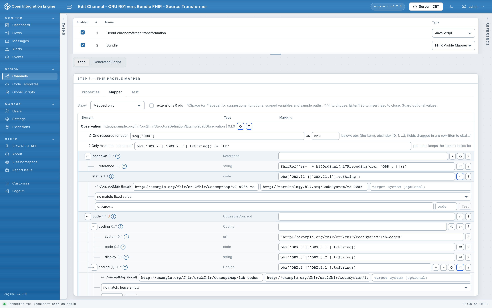

# OIE FHIR Profile Mapper

A plugin for [Open Integration Engine](https://github.com/OpenIntegrationEngine/engine)
(OIE 4.7, Web Admin 1.3). It builds FHIR resources and Bundles from business
messages.
It requires the [**FHIR Data Type**](https://github.com/matthydehoog/fhir-datatype-Eclipse-OIE)
plugin, version 1.5.1 ([release](https://github.com/matthydehoog/fhir-datatype-Eclipse-OIE/releases/tag/v1.5.1)).
FHIR Profile Mapper is a separate project, not part of FHIR Data Type: please report
its issues [here](https://github.com/kazepoy/oie-fhir-profile-mapper-plugin/issues).

## FHIR Profile Mapper

A transformer step that maps a message onto a FHIR profile: profile tree, slices,
expressions, conditions, iterations, translations, references between resources,
FHIR validation and per-rule diagnostics.



## Try it

```sh
cd demo
docker compose up -d --build
python3 examples/check.py   # sends messages through the demo channels
```

Administration: <https://localhost:8443/oie-webadmin/> (`admin` /
`demo-fhir-mapper-admin`). See the [demo guide](doc/Demo.md) (in French).

## Documentation

Detailed documentation is in French:

- [Development, installation and releases](doc/Developpement.md)
- [Mapping format and execution](doc/Specification-mapping.md)
- [Graphical mapper](doc/Mappeur-graphique.md)
- [Execution traces](doc/Trace.md) (step tests and processed messages)
- [Code assistants and AI workflow](doc/Assistants-et-IA.md)
- [FHIR Data Type integration](doc/Integration-FHIR-Data-Type.md)
- [Platform limits](doc/limites-plateforme.md) (what the mapper works around, upstream requests)
- [Demo](doc/Demo.md)
- [Project plan](doc/Plan.md)

License: [Mozilla Public License 2.0](LICENSE).
