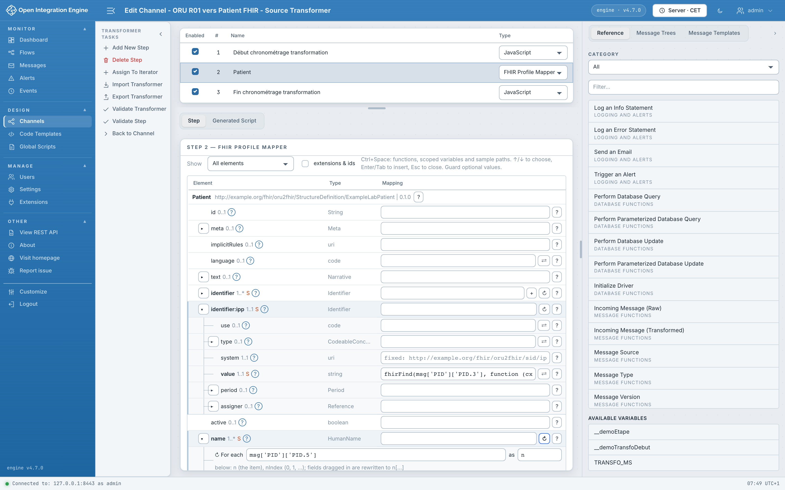
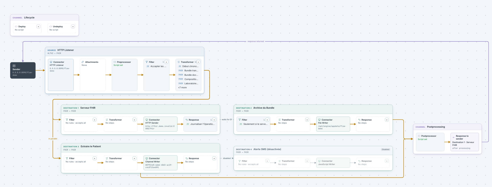
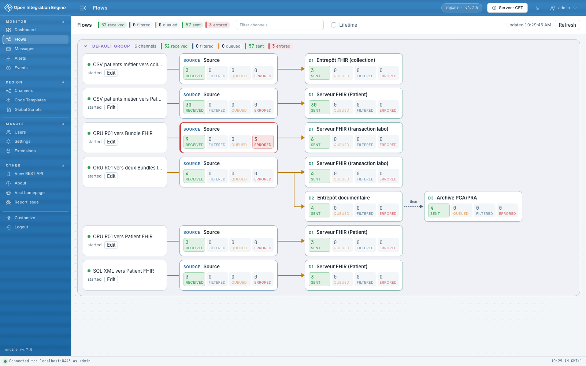

# OIE FHIR Profile Mapper

A plugin for [Open Integration Engine](https://github.com/OpenIntegrationEngine/engine)
(OIE 4.7, Web Admin 1.3). It builds FHIR resources and Bundles from business
messages, and shows how messages move through each channel.
It requires the [**FHIR Data Type**](https://github.com/matthydehoog/fhir-datatype-Eclipse-OIE)
plugin, version 1.5.1 ([release](https://github.com/matthydehoog/fhir-datatype-Eclipse-OIE/releases/tag/v1.5.1)).

## FHIR Profile Mapper

A transformer step that maps a message onto a FHIR profile: profile tree, slices,
expressions, conditions, iterations, translations, references between resources,
FHIR validation and per-rule diagnostics.



## Flow

> **Planned move.** Flow and Flows have nothing to do with FHIR: they work on any
> channel. They ship here for now and will be extracted into a separate plugin.

The **Flow** tab of the channel editor draws the path of a message: source,
destination chains, postprocessing and response. Every component opens its editor,
and `+` adds a filter rule or a step. Three layouts: Line, Columns, Bands.



## Flows

The **Flows** view (Monitor section) shows deployed channels by group, one channel
per row, with message counters for each connector. A counter opens Messages on the
right connector and status.



## Try it

```sh
cd demo
docker compose up -d --build
python3 examples/check.py   # sends messages through the demo channels
```

Administration: <https://localhost:8443/oie-webadmin/> (`admin` /
`demo-fhir-mapper-admin`). See the [demo guide](docs/Demo.md) (in French).

## Documentation

Detailed documentation is in French:

- [Development, installation and releases](docs/Developpement.md)
- [Mapping format and execution](docs/Specification-mapping.md)
- [Graphical mapper](docs/Mappeur-graphique.md)
- [Execution traces](docs/Trace.md) (step tests and processed messages)
- [Code assistants and AI workflow](docs/Assistants-et-IA.md)
- [Flow and Flows](docs/Channel-Flow.md)
- [FHIR Data Type integration](docs/Integration-FHIR-Data-Type.md)
- [Demo](docs/Demo.md)
- [Project plan](docs/Plan.md)

License: [Mozilla Public License 2.0](LICENSE).
