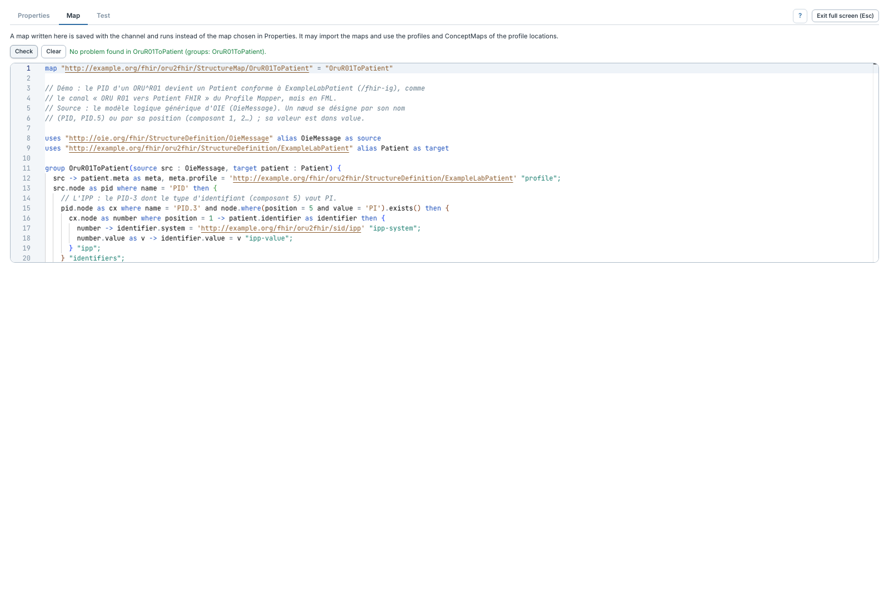

# FHIR FML Transform

[Accueil du manuel](../README.md)

Ce transformeur exécute une map **FHIR Mapping Language** et publie la ressource
qu'elle produit. Il convient aux transformations que l'on souhaite exprimer
explicitement en FML, avec groupes de règles, imports et traductions.

- [Configurer une étape et choisir une map fichier](configurer.md)
- [Écrire une map dans l'étape](editer-map.md)
- [Vérifier la map et corriger une erreur](verifier.md)
- [Tester et lire le résultat](tester.md)
- [Explorer le modèle source OieMessage](modele-oie.md)
- [Publier, valider et passer des variables de contexte](sortie.md)

Une map écrite dans **Map** est prioritaire sur la map sélectionnée dans
**Properties**. Les messages sont fournis selon le modèle générique `OieMessage`.
Les modèles logiques HL7 v2 typés et les mêmes jeux d'essai persistants que le
Profile Mapper ne sont pas disponibles actuellement.

Une map FML construit sa propre ressource, éventuellement un Bundle. Elle ne
partage pas les Bundles nommés du Profile Mapper. Il n'existe pas de trace FML
par règle ni de prise en charge de `resolveReference` et `performSearch`.
Pour la syntaxe et les limites détaillées : [référence FML](../../Transformation-FML.md).
