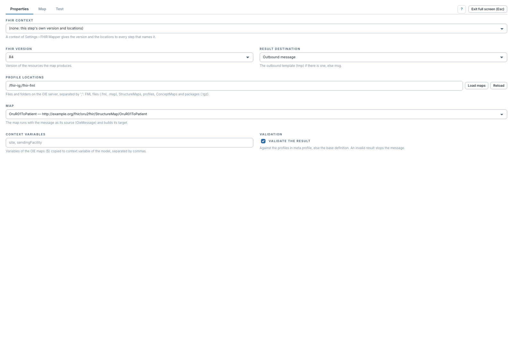

# Configurer l'étape et choisir une map

[Manuel](../README.md) · [FML](README.md)

Dans un transformeur OIE, ajouter une étape de type **FHIR FML Transform**, puis
ouvrir **Properties**.

1. Choisir le **FHIR context**, ou laisser le contexte vide et renseigner la
   version FHIR et les **Profile locations** de l'étape.
2. Donner des emplacements accessibles au serveur : fichiers `.fml`, `.map`,
   ressources StructureMap JSON/XML, dossiers ou packages `.tgz`. Dans les
   propriétés de l'étape, séparer les chemins par `;`.
3. Cliquer **Load maps** pour charger la liste.
4. Choisir la map par son titre et sa canonique dans **Map**.
5. Régler la sortie et la validation, puis essayer un message dans **Test**.

Avec un contexte, ses packages et sa version remplacent ceux de l'étape. Le
contexte doit contenir les profils, ConceptMaps et maps importées nécessaires.
La liste peut signaler des fichiers illisibles ; corriger leur chemin ou leur
contenu avant de conclure que le catalogue est complet.

**Reload** oublie les maps en mémoire et relit les emplacements. L'utiliser après
une modification de fichier serveur ; un redéploiement recharge également les
maps pour l'exécution du canal. **Load maps** actualise la liste sans demander
explicitement cette purge.

Si **Map** contient du texte dans son onglet dédié, cette map inline est utilisée
à la place de la sélection de **Properties**. **Clear** dans l'onglet Map
permet de revenir à la map fichier sélectionnée.
