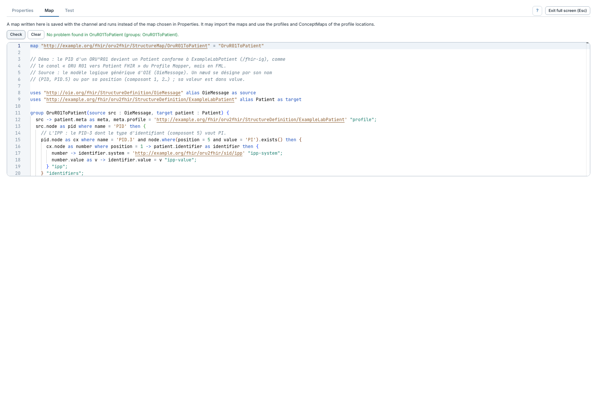
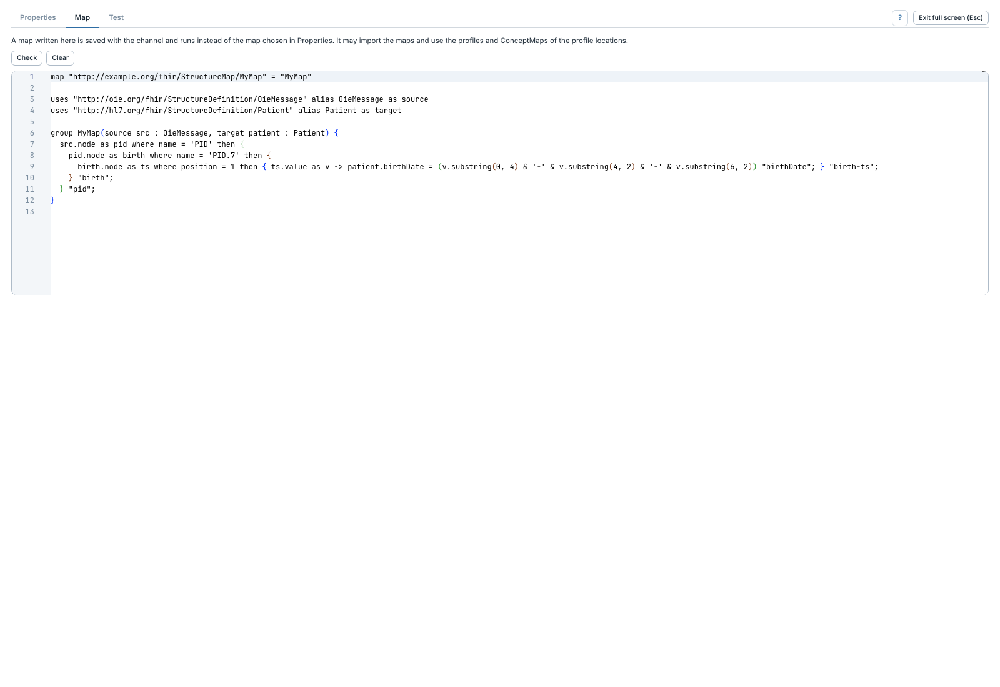

# Écrire une map dans l'étape

[Manuel](../README.md) · [FML](README.md)

L'onglet **Map** conserve le texte FML avec le canal. Il est prioritaire sur la
map choisie dans **Properties**.

1. Ouvrir **Map**, puis coller ou écrire la map.
2. Déclarer sa canonique, ses modèles source/cible et au moins un groupe.
3. Cliquer **Check**, puis réaliser un test avec un message.
4. Enregistrer et redéployer le canal pour appliquer la map.

L'éditeur colore les mots-clés, chaînes et commentaires. **Full screen** permet
d'éditer sur toute la page. La complétion FML avancée n'est pas encore fournie.

## Partir d'un exemple

Quand aucune map inline n'est renseignée, **Start from an example** insère un
petit modèle à adapter. Ce bouton n'effectue pas le mapping complet de votre
message et ne remplace pas les tests.

Le source est `OieMessage` ; les règles parcourent ses nœuds par nom, position
ou occurrence. Les `uses` de la cible et les `imports` doivent être accessibles
dans les emplacements choisis. `translate()` utilise les ConceptMaps de ces
emplacements. Le [modèle reçu](modele-oie.md) aide à écrire les accès.

**Clear** vide le texte inline et rend de nouveau active la map sélectionnée
par sa canonique dans **Properties**. Cela modifie l'étape en cours ; enregistrer
le canal pour conserver ce changement.
