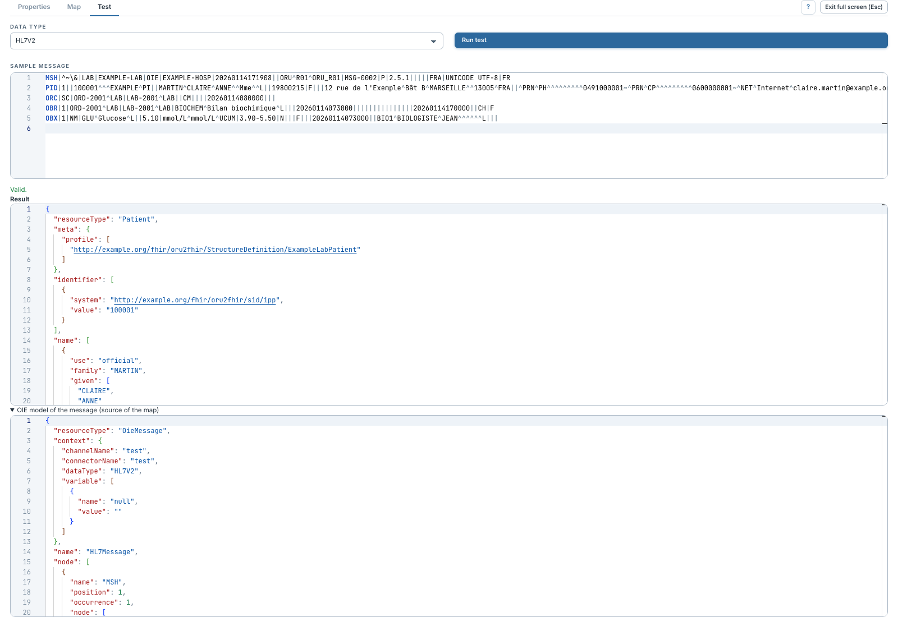

# Explorer le modèle source OieMessage

[Manuel](../README.md) · [FML](README.md)

Une map ne reçoit pas directement les noms de propriétés d'un modèle logique
HL7 v2 typé. Elle reçoit l'arbre générique **OieMessage** construit à partir du
message interne d'OIE.

1. Exécuter un [test](tester.md).
2. Ouvrir **OIE model of the message (source of the map)**.
3. Repérer les nœuds `node`, leurs `name`, `position`, `occurrence` et `value`.
4. Reprendre ces informations dans les règles FML.

| Champ | Signification |
|---|---|
| `name` | Nom du nœud : segment `PID`, champ `PID.5`, composant, élément XML ou clé JSON. |
| `position` | Position portée par son nom ou rang parmi ses frères, à partir de 1. |
| `occurrence` | Rang parmi les nœuds de même nom, à partir de 1. |
| `value` | Texte d'un nœud feuille. |
| `node` | Liste des enfants. |
| `attribute` | Attributs XML. |
| `context` | Métadonnées disponibles et variables de contexte demandées. |

Pour un HL7 v2, `PID.8` contient généralement le composant `PID.8.1` : ne pas
chercher sa valeur uniquement sur le champ parent. Les champs vides peuvent
exister sans `value`. Pour un JSON, les propriétés deviennent des nœuds ; un
tableau produit des occurrences.

Ce modèle reflète le parseur utilisé par le canal. Une map écrite pour le
parseur habituel peut nécessiter des accès différents avec le Strict Parser.
Les modèles logiques typés ne sont pas encore disponibles dans cet éditeur.
