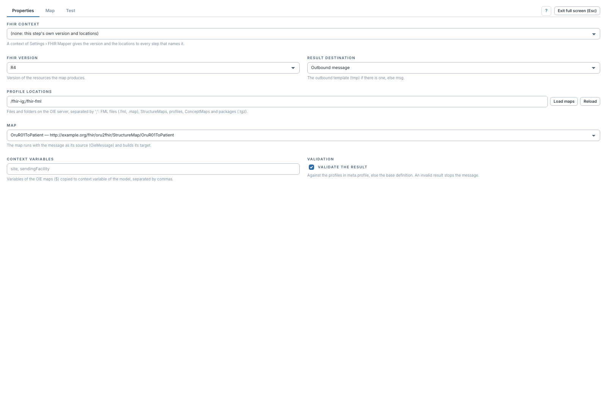

# Publier, valider et passer des variables

[Manuel](../README.md) · [FML](README.md)

Dans **Properties**, configurer la destination et les variables avant de tester
le canal complet.

**Result destination** propose **Outbound message**, ou **Channel Map variable**
avec un nom de variable. Pour le message sortant, le transformeur publie dans
le template `tmp` lorsqu'il existe, sinon dans `msg`. La variable de Channel Map
permet à une destination suivante d'utiliser le résultat.

**Context variables** est une liste de noms séparés par des virgules, par
exemple `site, sendingFacility`. Le transformeur lit leurs valeurs dans les maps
OIE via `$` et les copie dans `context.variable` du modèle source. Les métadonnées
présentes, comme le canal ou le message, sont également exposées dans le contexte.

## Validation

La case **Validate the result** contrôle la validation de sortie FML. Elle
s'appuie sur les profils de `meta.profile`, sinon sur la définition de base.
Un résultat invalide arrête le message avec un diagnostic.

Dans l'interface actuelle, FML conserve cette **case propre à l'étape** : la
sélection d'un contexte donne sa version et ses emplacements, mais ne remplace
pas ce contrôle par le sélecteur `inherit / always / off` du Profile Mapper.
Vérifier la case explicitement, même si le panneau mentionne la politique du
contexte. La validation éventuelle du datatype de sortie OIE est distincte.

Enregistrer et redéployer le canal pour appliquer les changements au traitement
réel. Le transformeur FML ne fournit pas de trace par règle équivalente à celle
du Profile Mapper ; utiliser les diagnostics de test et les erreurs du message.
