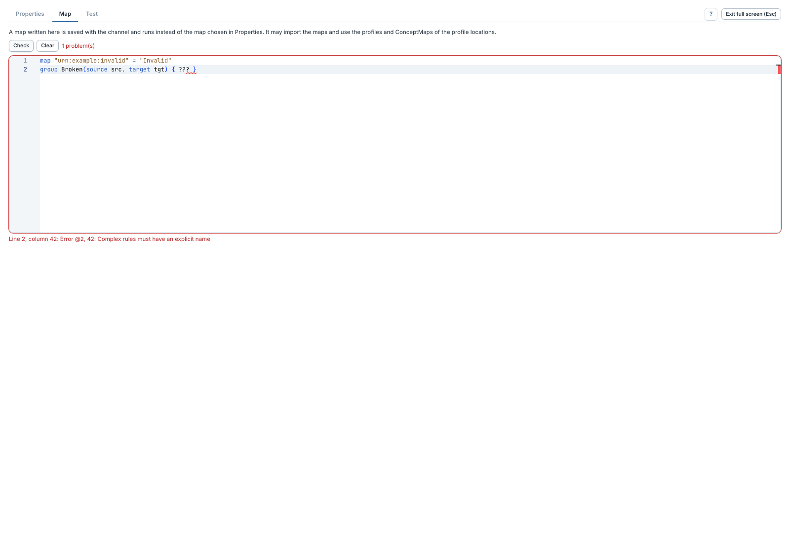

# Vérifier une map et corriger les erreurs

[Manuel](../README.md) · [FML](README.md)

**Check** analyse le texte inline sur le serveur. Le droit
`Edit FHIR FML transforms` est nécessaire.

1. Dans **Map**, cliquer **Check**.
2. Attendre le résultat : le succès indique notamment le nom de la map analysée.
3. En cas d'erreur, lire la ligne, la colonne et le message sous l'éditeur.
4. Corriger le texte ou rendre ses dépendances accessibles, puis relancer Check.

Les erreurs du parseur sont rattachées à une position et marquées dans le code.
Les déclarations `uses` et `imports` introuvables sont également signalées.
Une erreur de dépendance peut demander de corriger les packages du contexte,
pas uniquement la ligne affichée.

**Check ne transforme pas de message.** Une map analysable peut encore échouer
sur une entrée particulière ou produire une ressource invalide. Utiliser ensuite
[Run test](tester.md) pour contrôler le résultat et sa validation.
