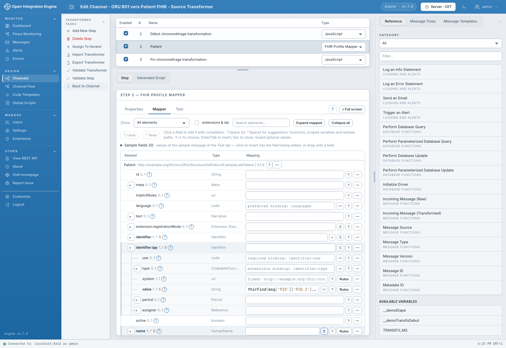

# Manuel utilisateur — OIE FHIR Mapper

Ce manuel explique les fonctions disponibles dans la branche `feat/refonte` au
12 novembre 2026, avec des captures prises dans la démonstration locale. Les
procédures sont en français ; les parcours existants et leurs captures utilisent
l’interface anglaise. Le plugin propose aussi une interface française, selon
les préférences du navigateur : voir [langues et thèmes](langues-et-themes.md).
Les noms, messages et identifiants visibles sont des données de démonstration.

## Choisir son parcours

| Je veux… | Ouvrir |
|---|---|
| Construire des ressources à partir d'un profil, sans écrire de map FML | [FHIR Profile Mapper](profile-mapper/README.md) |
| Écrire ou exécuter une transformation FML | [FHIR FML Transform](fml/README.md) |
| Partager les packages, la terminologie et les réglages FHIR entre étapes | [Settings › FHIR Mapper](settings/README.md) |
| Changer la langue ou le thème | [Langues et thèmes](langues-et-themes.md) |
| Faire un premier essai dans la démo | [Démarrage](demarrage.md) |
| Comprendre l'échec d'un message traité | [Trace des messages](profile-mapper/trace-messages.md) |

## Avant de commencer

Le serveur doit disposer du plugin FHIR Mapper et du prérequis **FHIR Data Type
1.5.1**. Les captures utilisent **OIE 4.7.0 et Web Admin 1.3**. L'installation et
le lancement de la démonstration sont décrits dans le [guide de démo](../../demo/Demo.md).
Les chemins de packages sont des chemins du **serveur OIE**, pas du navigateur.

L'accès aux canaux et à leur enregistrement dépend des droits OIE habituels.
Les fonctions du plugin ont aussi leurs permissions :

| Opération | Permission |
|---|---|
| Charger un profil, éditer et compiler un mapping | `Edit FHIR mappings` |
| Exécuter un aperçu Profile Mapper | `Test FHIR mapper steps` |
| Charger, éditer et vérifier des maps FML | `Edit FHIR FML transforms` |
| Exécuter un test FML | `Test FHIR FML transforms` |
| Enregistrer les contextes partagés | `Manage FHIR mapper settings` |

## Enregistrer et appliquer

Une modification de règle ou de propriété appartient à l'édition du canal en
cours. Revenir au canal, l'**enregistrer**, puis le **redéployer** pour modifier
le traitement des nouveaux messages. Un test utilise les modifications en cours
sans les déployer. Il ne constitue pas un enregistrement du canal.

Le bouton **Save** de *FHIR Mapper Tasks* enregistre les réglages du serveur
séparément (ils sont également inclus dans le Backup/Restore Config natif OIE).
Redéployer les canaux concernés après un changement de contexte.

## Périmètre du manuel

Le Profile Mapper propose des exemples enregistrés, une comparaison de résultats
et une trace par règle. FML dispose d'un éditeur, de **Check** et d'un test avec
le modèle source ; il n'offre pas encore la même gestion de jeux d'essai ni une
trace par règle. L'aperçu Profile Mapper peut exécuter l'étape seule ou toutes
les étapes Profile Mapper actives du transformeur. Le rejeu du canal déployé
reste le contrôle d'intégration final.

Les captures ne démontrent pas l'activation de toutes les options simultanément.
En particulier, `demo-labo` peut être configuré avec la validation désactivée :
[choisir la validation explicitement](settings/validation.md).

Les références techniques restent disponibles dans les guides
[Profile Mapper](../../reference/Mappeur-graphique.md), [FML](../../reference/Transformation-FML.md) et
[format de mapping](../../reference/Specification-mapping.md).

## À propos des captures

Les captures proviennent de la démo locale sous Chromium, en thème clair,
principalement à 1 600 × 1 100 pixels. Certaines ciblent uniquement un panneau.
Elles illustrent les fonctions réellement disponibles, sans montage d'interface.
Cliquer ou ouvrir l'image seule pour lire un champ à sa résolution d'origine.

Pour les renouveler, partir des canaux de démonstration, effectuer les opérations
de la page sans enregistrer les modifications d'illustration, puis capturer la
zone pertinente. Employer des messages fictifs et vérifier l'absence de secrets
avant d'ajouter les images au dépôt. Les captures de test montrant un défaut
introduisent volontairement un exemple différent ou une expression invalide.
