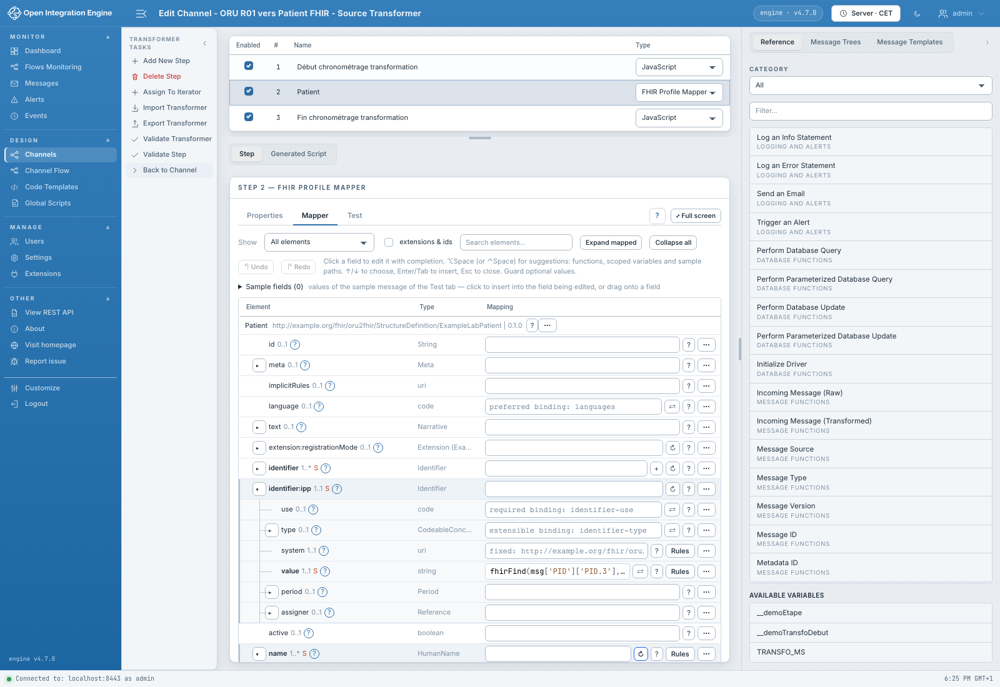

# Réaliser un premier mapping

[Accueil du manuel](README.md)

Pour suivre exactement les captures, ouvrir le canal **ORU R01 to FHIR Patient**
dans la démonstration.

1. Dans **Channels**, ouvrir le canal.
2. Choisir **Source**, puis **Edit Transformer**.
3. Sélectionner l'étape **Patient**, de type **FHIR Profile Mapper**.
4. Ouvrir **Properties** : vérifier le contexte `demo-labo` et le profil cible.
5. Dans **Mapper**, cliquer **Full screen**, puis rechercher `family`.
6. Lire l'expression existante : elle prend le nom dans le message HL7 v2.
7. Dans **Test**, choisir l'exemple **ORU minimal**, puis cliquer **Run**.
8. Lire le résultat et le statut de validation. Pour rejouer les exemples
   enregistrés, cliquer **Run all**.

Pour créer une nouvelle étape, utiliser **Add New Step** dans le transformeur,
puis choisir le type **FHIR Profile Mapper** ou **FHIR FML Transform** dans sa
colonne de type. Renseigner ensuite ses propriétés. La sélection d'un profil
est décrite [ici](profile-mapper/profil.md) ; celle d'une map FML
[ici](fml/configurer.md).

Un profil ou une map absente du catalogue doit d'abord être rendu accessible au
serveur via ses [packages et fichiers](settings/packages.md).

Un test réussi vérifie l'étape sur cet exemple. Enregistrer puis redéployer le
canal avant d'essayer un message sur son point d'entrée. Les essais illustrés
dans le manuel ne nécessitent pas de modifier durablement les canaux de démo.
