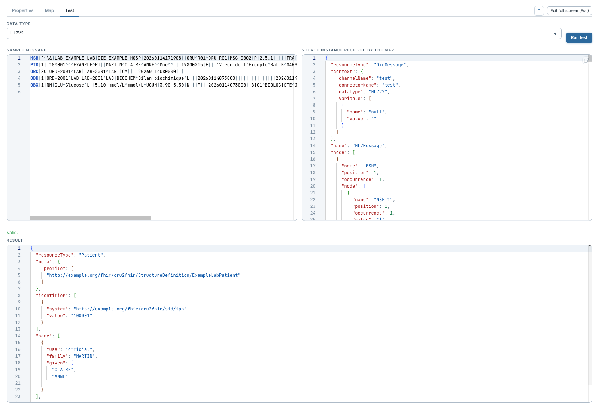

# Explorer le modèle source OieMessage

[Manuel](../README.md) · [FML](README.md)

Cette page concerne le choix **Generic OIE message**. La map reçoit l'arbre
**OieMessage** construit à partir du message interne d'OIE. Pour les groupes et
composants HAPI, choisir plutôt le [modèle HL7 v2 typé](modeles-sources.md).

1. Exécuter un [test](tester.md).
2. Examiner **Source instance received by the map**, à côté du message exemple
   ou dessous si la zone est étroite.
3. Repérer les nœuds `node`, leurs `name`, `position`, `occurrence` et `value`.
4. Reprendre ces informations dans les règles FML.

| Champ | Signification |
|---|---|
| `name` | Nom du nœud : segment `PID`, champ `PID.5`, composant, élément XML ou clé JSON. |
| `position` | Position portée par son nom ou rang parmi ses frères, à partir de 1. |
| `occurrence` | Rang parmi les nœuds de même nom, à partir de 1. |
| `value` | Texte d'un nœud feuille. |
| `node` | Liste des enfants. |
| `attribute` | Attributs XML. |
| `context` | Métadonnées disponibles et variables de contexte demandées. |

Pour un HL7 v2, `PID.8` contient généralement le composant `PID.8.1` : ne pas
chercher sa valeur uniquement sur le champ parent. Les champs vides peuvent
exister sans `value`. Pour un JSON, les propriétés deviennent des nœuds ; un
tableau produit des occurrences.

Ce modèle reflète le message sérialisé par OIE. Une map fondée sur les noms HAPI
du Strict Parser doit sélectionner le mode typé et sa canonique plutôt que de
parcourir ces noms dans l'enveloppe générique.
