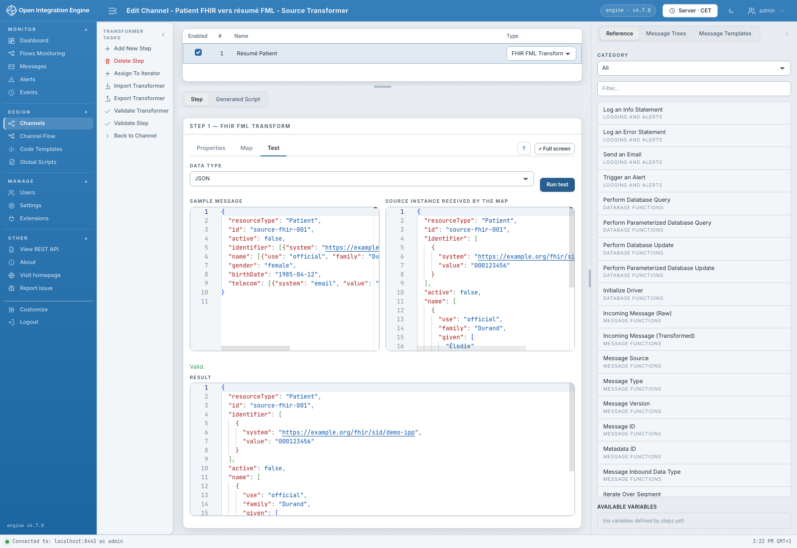

# Tester une transformation FML

[Manuel](../README.md) · [FML](README.md)

L'onglet **Test** exécute la map sur le serveur avec le message fourni. Le droit
`Test FHIR FML transforms` est nécessaire.

1. Configurer les emplacements et la map, ou écrire une map inline.
2. Choisir **Data type** et coller le **Sample message** correspondant.
3. Cliquer **Run test**.
4. Lire les erreurs, le statut de validation et **Result**.
5. Comparer le message avec **Source instance received by the map**, affichée
   à droite de l'exemple, ou juste dessous lorsque la zone est étroite.
   C'est la source réellement remise au groupe d'entrée.

Les éditeurs partagent la hauteur disponible : le résultat reste sous les deux
sources, sans ajouter un défilement du panneau autour de celui des éditeurs.
Utiliser **Full screen** pour agrandir l'espace de comparaison.

Le template entrant du transformeur initialise le message. Le dernier exemple
est mémorisé dans ce navigateur pour ce canal/transformeur. Il n'existe pas
encore, pour FML, de liste d'exemples enregistrés avec résultat attendu ni de
bouton Run all comparable à celui du Profile Mapper.

Les diagnostics distinguent les problèmes de configuration, lecture d'entrée,
transformation et validation. Pour une syntaxe FML incorrecte, revenir dans
**Map** et utiliser [Check](verifier.md). Pour un accès qui ne trouve aucun
nœud, examiner le [modèle source](modeles-sources.md).

Le test ne déploie pas le canal et ne vérifie pas toutes ses étapes. Une map
qui produit un Bundle doit construire elle-même ses ressources et références ;
les Bundles nommés du Profile Mapper ne sont pas partagés avec elle.
