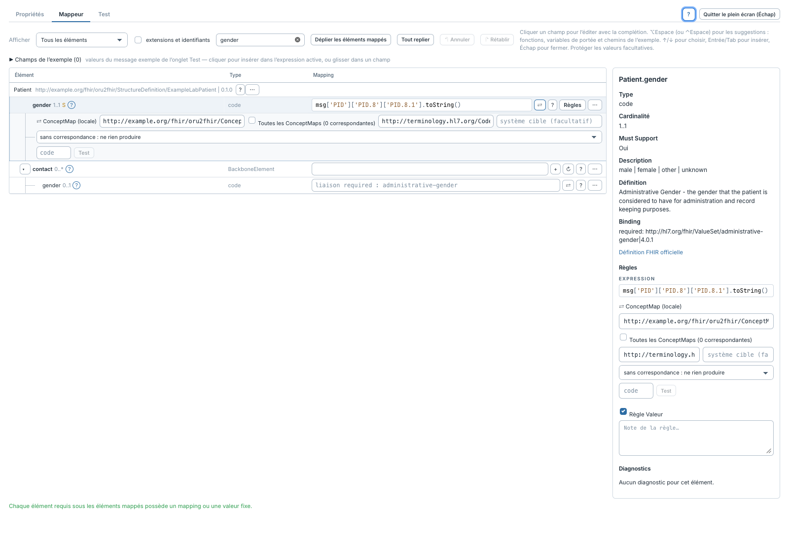
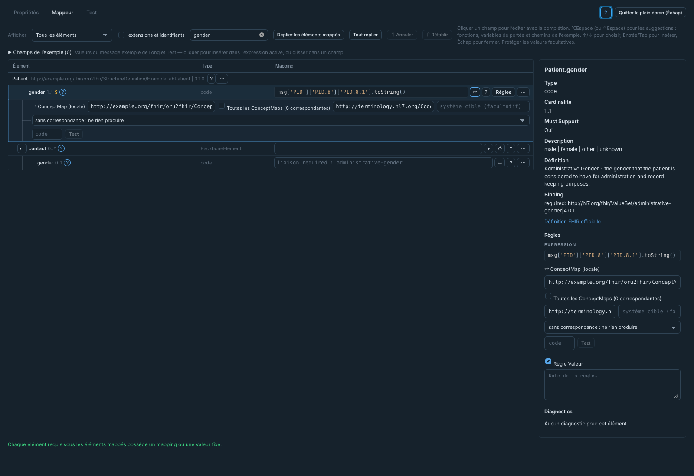

# Langues et thèmes

[Accueil du manuel](README.md)

Le plugin affiche ses commandes, aides et messages d’interface en français ou en
anglais. Il utilise la première langue prise en charge parmi les préférences du
navigateur ; si aucune ne correspond, il utilise l’anglais.

1. Dans les préférences de langues du navigateur, placer le français ou l’anglais
   avant l’autre langue.
2. Recharger Web Admin, puis ouvrir une étape FHIR Profile Mapper, FHIR FML
   Transform ou les réglages FHIR Mapper.
3. Pour changer de thème, ouvrir la palette de commandes de Web Admin et lancer
   **Toggle light/dark mode**. Le plugin suit ce choix.

Le choix de langue du plugin ne traduit pas les commandes du shell Web Admin.
Les noms des canaux et contextes, les expressions, les chemins FHIR, les codes et
les URL restent inchangés. Les définitions des profils et les diagnostics du
serveur sont affichés dans leur langue d’origine. Changer de langue ou de thème
ne modifie pas les règles enregistrées.

## Français, thème clair

## Français, thème sombre

Ces captures proviennent de la démo locale ; le message et le profil sont des
données de démonstration. Les autres pages du manuel conservent leurs captures
en anglais : par exemple *Properties* correspond à *Propriétés*, *Mapper* à
*Mappeur*, *Run* à *Exécuter* et *Save contexts* à *Enregistrer les contextes*.
