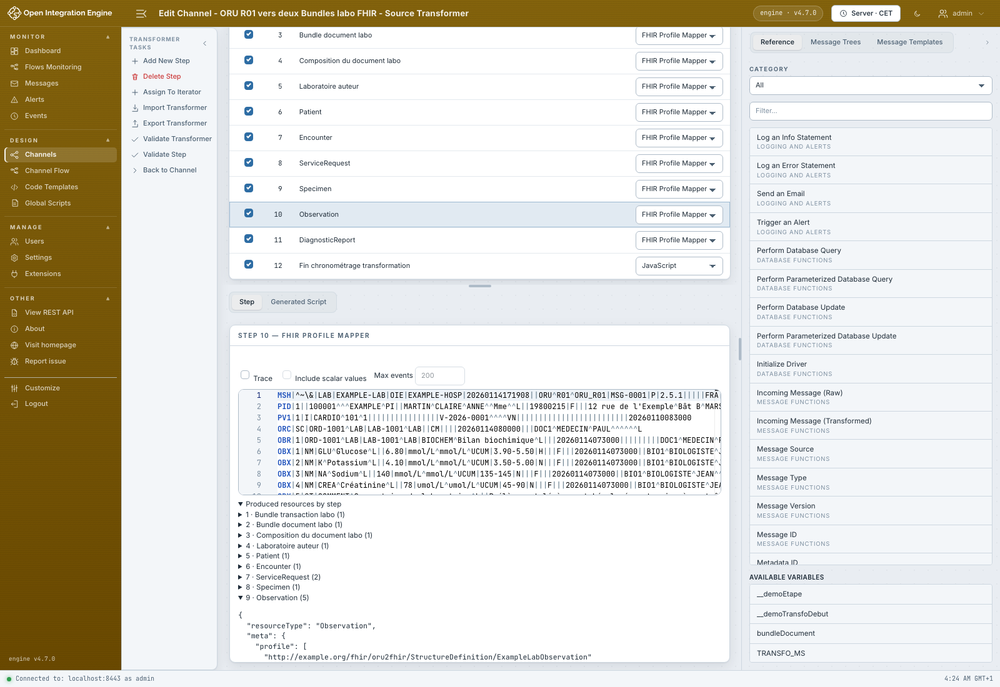

# Tester plusieurs étapes ensemble

[Manuel](../README.md) · [Profile Mapper](README.md)

Dans **Test**, choisir **Preview scope / Périmètre de l’aperçu** puis
**Profile Mapper steps of this transformer / Étapes Profile Mapper de ce transformeur**.
Cliquer **Run / Exécuter**. Le droit `Test FHIR mapper steps` reste nécessaire.

Les Profile Mapper activés du même transformeur s’exécutent dans leur ordre
actuel, avec le brouillon ouvert. Les références sont réelles, les Bundles sont
finalisés ensemble et les sorties ne sont publiées que si tous les contrôles
réussissent. Aucun canal n’est enregistré ni déployé par ce test.

- **Produced resources by step** montre les ressources produites à chaque étape,
  avant assemblage final : un Bundle nouvellement créé y est encore vide.
- **Result** contient le message sortant final.
- **Published channel variables** contient les autres résultats, par exemple
  `bundleDocument` pour le document labo. Un transformeur publiant seulement des
  variables n’a pas de résultat principal.
- Les erreurs identifient l’étape et la règle ; une erreur de finalisation
  indique notamment une référence réservée non résolue ou un résultat invalide.
  Sélectionner l’étape indiquée pour éditer sa règle. **Go to rule** ne vise que
  l’étape actuellement ouverte.

Le message fourni est l’entrée commune des étapes. Les étapes JavaScript, FML,
Iterators, transports et pré/postprocesseurs sont exclus. En destination, fournir
un message déjà préparé par la source. Ce test ne remplace donc pas un essai de
la chaîne complète déployée. La limite JavaScript de dix secondes est commune
aux étapes ; les appels FHIR/Java peuvent dépasser ce délai.

Pour retrouver l’aperçu isolé et ses références de remplacement, choisir
**This step only / Cette étape uniquement**. Le périmètre choisi est enregistré
avec chaque sample ; les anciens samples restent isolés. **Run all** respecte
le périmètre de chacun. Le résultat attendu compare le message sortant, pas les
variables publiées.
