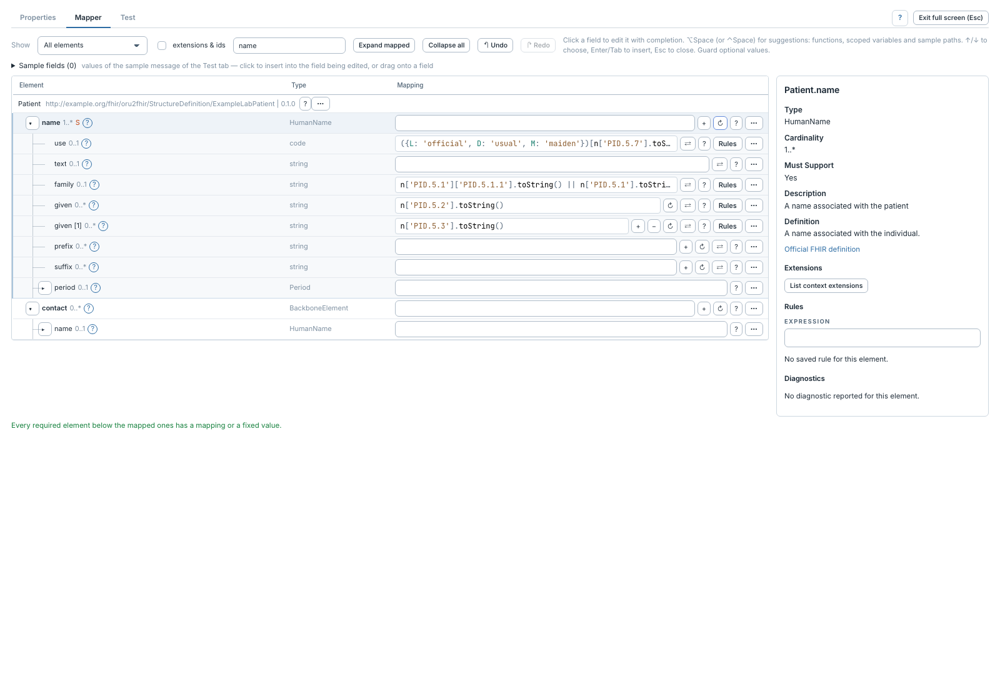
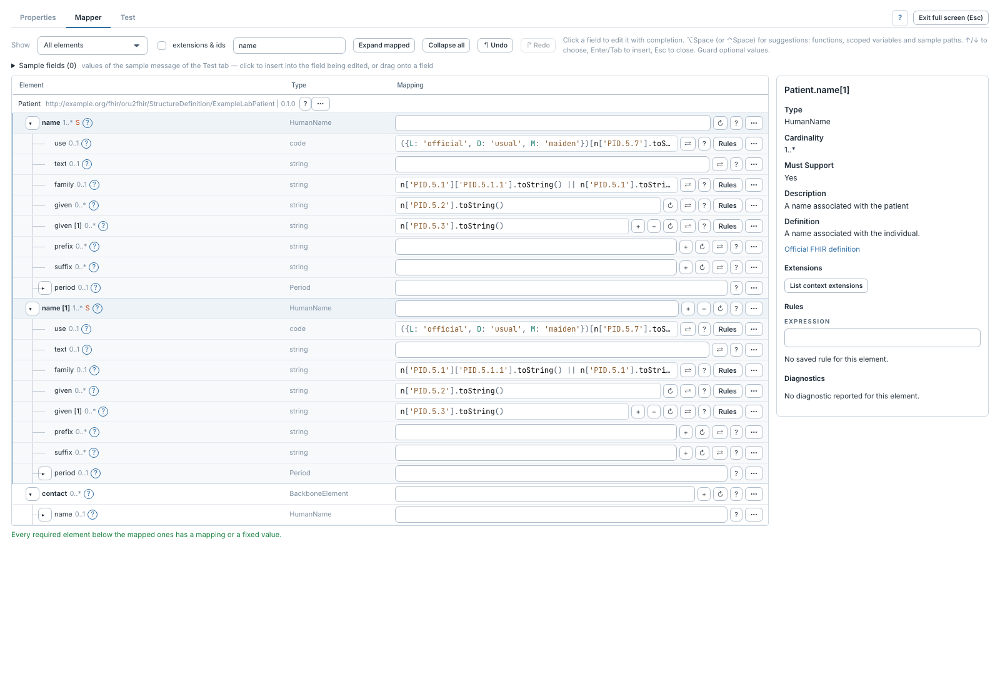

# Menu d'actions, occurrences et duplication

[Manuel](../README.md) · [Profile Mapper](README.md)

Ouvrir le menu d'une ligne par clic droit, **Maj+F10** sur son nom ou **⋯**.
Les actions impossibles pour cet élément sont grisées.

Le menu propose l'inspection, l'ajout d'une occurrence, la duplication,
l'itération, la condition, la traduction, l'activation des règles de la branche
et leur copie en JSON. Les boutons **+ / −** de l'arbre permettent aussi d'ajouter
une occurrence ou de retirer la dernière occurrence ajoutée avec ses mappings.

## Dupliquer une branche

1. Choisir une occurrence répétable qui possède des mappings.
2. Vérifier qu'elle n'est pas itérée et qu'une occurrence supplémentaire est
   autorisée par la cardinalité.
3. Choisir **Duplicate branch**.
4. Adapter les expressions de la nouvelle occurrence.

La copie garde les expressions, conditions, traductions, notes, activations et
occurrences imbriquées. Ses chemins de destination et IDs de règles sont nouveaux.
Les expressions restent identiques : une référence ou un indice source ne change
pas automatiquement. **Undo / Redo** restaure la copie et conserve ses IDs.

**Disable branch rules** désactive les règles de la branche. Si elles sont toutes
désactivées, **Enable branch rules** les réactive. **Copy branch as JSON** copie
un tableau de règles dans le presse-papiers : ce n'est pas un export d'étape
complet. Pour ce dernier, utiliser [Edit as JSON](json-et-script.md).
