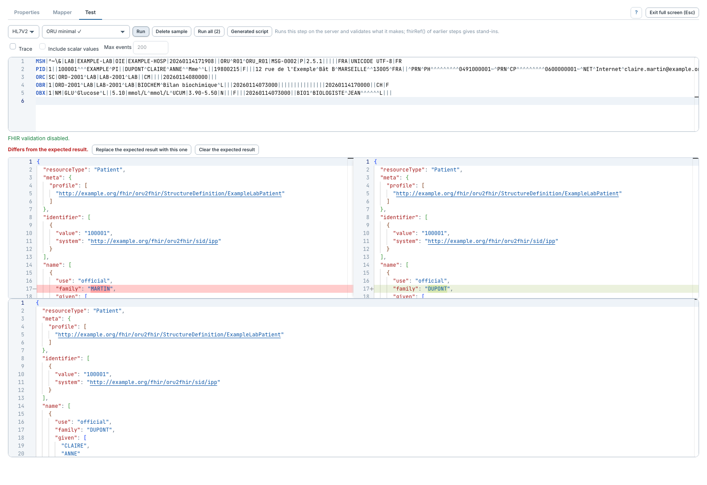

# Fixer un résultat attendu et comparer

[Manuel](../README.md) · [Profile Mapper](README.md)

Un exemple enregistré peut posséder un résultat de référence.

1. Choisir l'exemple dans **Sample**, puis **Run**.
2. Contrôler le résultat et sa validation.
3. Cliquer **Use this result as expected**. Si une référence existe déjà, le
   bouton devient **Replace the expected result with this one**.
4. Enregistrer le canal pour conserver cette référence.
5. Modifier une règle ou un exemple, puis relancer le test.

**Matches the expected result.** indique une correspondance.
**Differs from the expected result.** ouvre une vue côte à côte du résultat
attendu et du résultat actuel. Lire l'écart avant de remplacer la référence :
un écart peut révéler une régression ou une modification volontaire.

Les URN UUID aléatoires sont renommés en préservant les relations de référence.
L’ordre des propriétés JSON et `meta.lastUpdated` sont neutralisés pour la comparaison.
Les autres différences de contenu restent significatives. **Clear the expected
result** retire la référence, sans supprimer l'exemple.

**Run all** utilise les mêmes références pour classer les exemples. Un exemple
sans résultat attendu peut passer malgré un changement de contenu ; voir la
colonne de détail de [Run all](tests-et-exemples.md).
