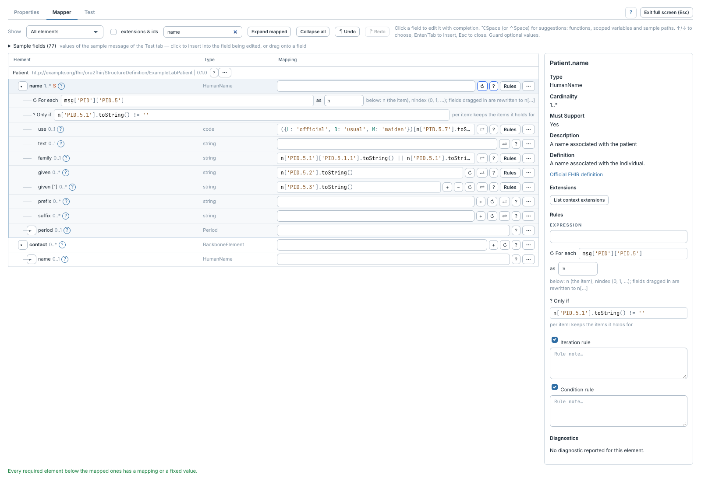

# Appliquer une condition

[Manuel](../README.md) · [Profile Mapper](README.md)

Une condition contrôle la création d'un élément et de ce qui se trouve dessous.



1. Cliquer **?** sur l'élément ou **Toggle condition** dans son menu.
2. Dans **Only if**, écrire une expression vraie ou fausse.
3. Utiliser les variables de la boucle si l'élément est itéré.

Exemple : ne conserver un nom que si son composant de nom de famille est rempli.

```javascript
n['PID.5.1'].toString() != ''
```

Une condition sur la racine contrôle la ressource entière. Une condition sur
un élément itéré est réévaluée pour chaque item.

Pour suspendre la condition sans perdre son texte, utiliser l'activation dans
**Rules**. Une condition désactivée ne filtre plus les éléments situés dessous :
ils peuvent donc être produits sans ce contrôle. Retirer la condition avec **?**
ou son menu supprime la règle d'édition correspondante ; **Undo** la restaure.

En cas de résultat absent, activer la [trace du test](diagnostics-et-traces.md)
pour voir si la condition a entraîné un événement `skipped`.
