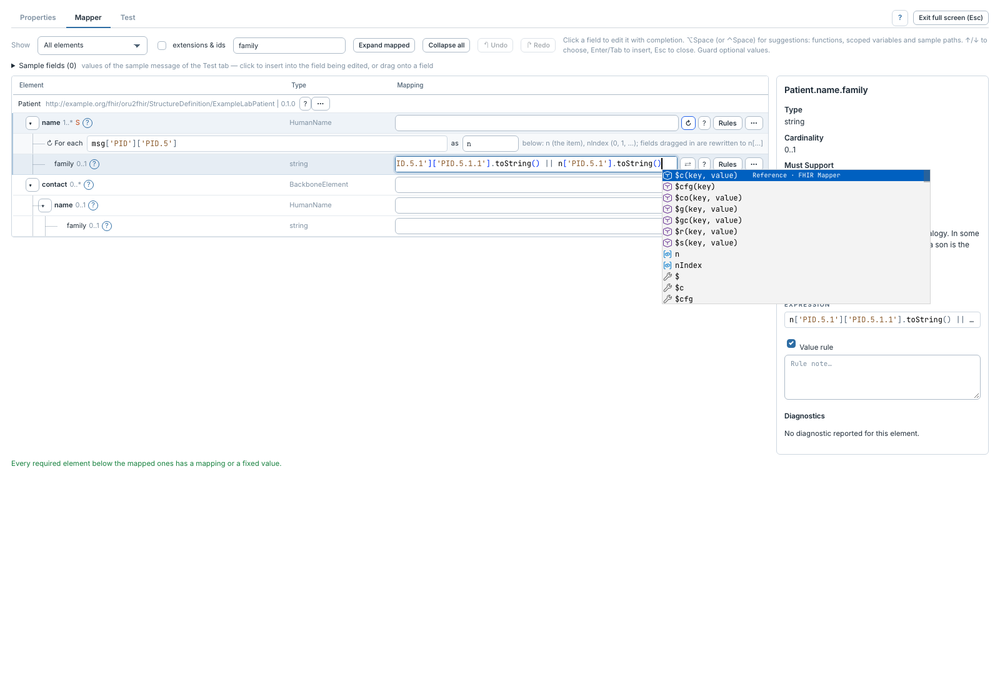
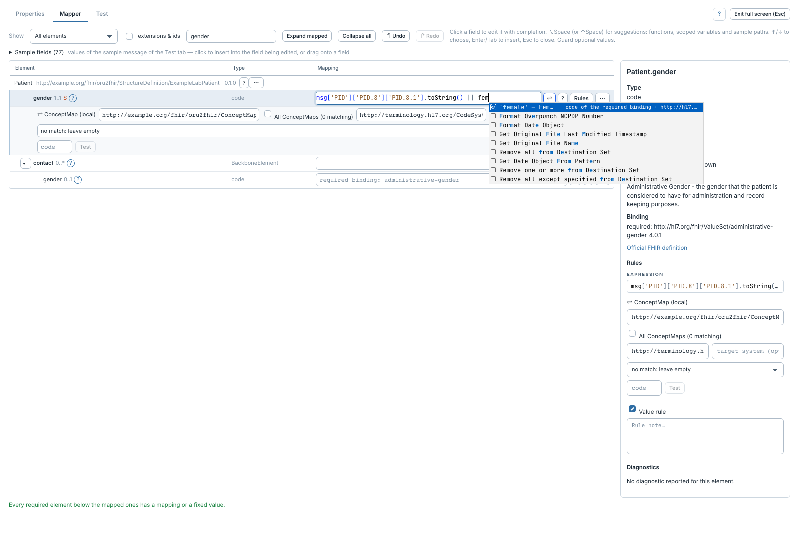
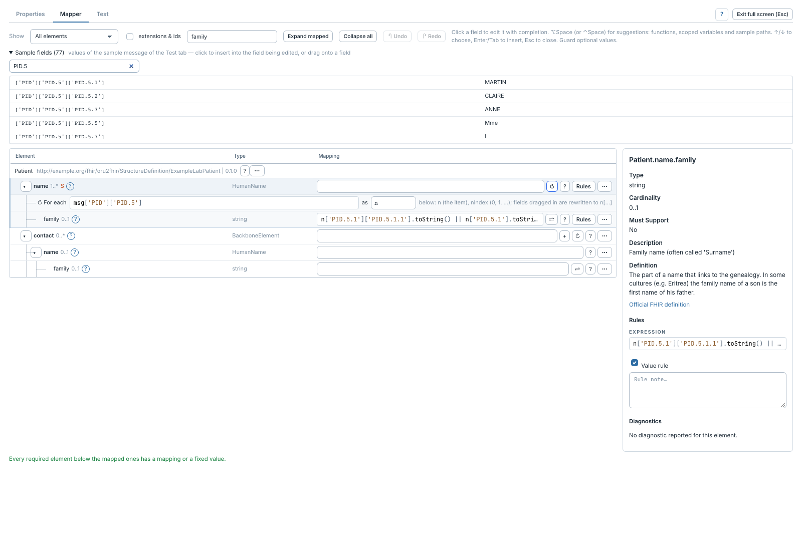

# Expressions, complétion et champs source

[Manuel](../README.md) · [Profile Mapper](README.md)

Cliquer le champ **Mapping** d'un élément ou son **Expression** dans
l'inspecteur. Il devient un éditeur de code JavaScript.



**Alt+Espace** ou **Ctrl+Espace** ouvre les propositions. Sur macOS,
**Option+Espace** évite le raccourci système de changement de source de saisie.
Choisir avec ↑/↓, insérer avec Entrée ou Tab, fermer avec Échap.



Les propositions comprennent les variables d'itération, fonctions du mappeur,
chemins renseignés dans l'exemple, modèles de garde, codes des bindings et
références disponibles. Une constante texte est une expression entre guillemets,
par exemple `'final'` ; `true` est un booléen.

```javascript
msg['PID']['PID.7']['PID.7.1'].toString()
```

Pour un message HL7 v2 lu comme XML interne, `.toString()` extrait le texte.
Pour un objet JSON, accéder directement à ses propriétés. Garder les accès aux
champs facultatifs :

```javascript
msg['PID']['PID.7'].length() > 0
  ? msg['PID']['PID.7']['PID.7.1'].toString()
  : undefined
```

## Insérer depuis l'exemple



1. Dans **Test**, fournir un message exemple et son type.
2. Revenir dans **Mapper** et ouvrir **Sample fields**.
3. Filtrer les chemins et valeurs, par exemple sur `PID.5`.
4. Cliquer d'abord le champ de destination, puis un champ source pour insérer
   son accès ; ou glisser le champ source vers l'expression.

Sous une itération, les chemins insérés sont adaptés à sa variable. Sans champ
d'édition actif, cliquer un champ source tente de copier son chemin dans le
presse-papiers. **Reference › FHIR Mapper** dans Web Admin décrit aussi les
fonctions du mappeur et leurs exemples.
