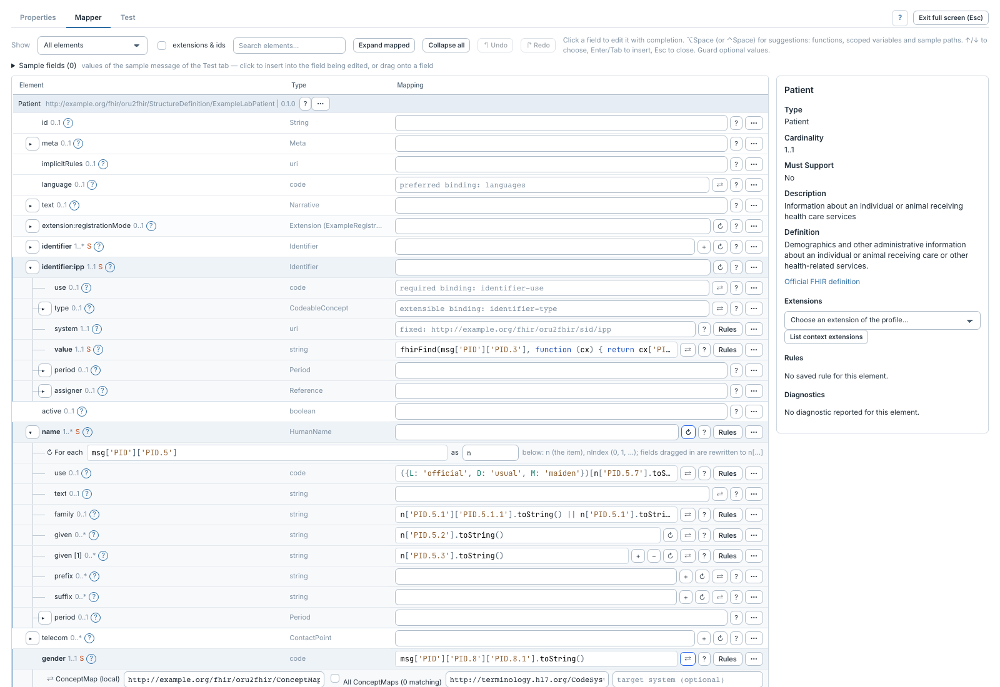
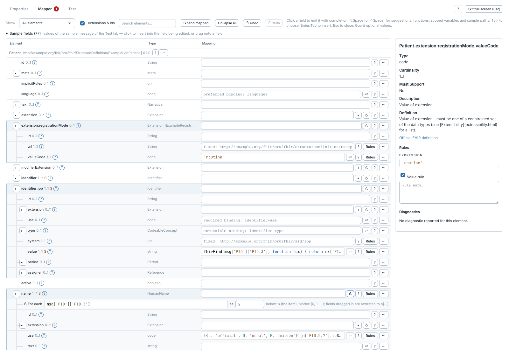
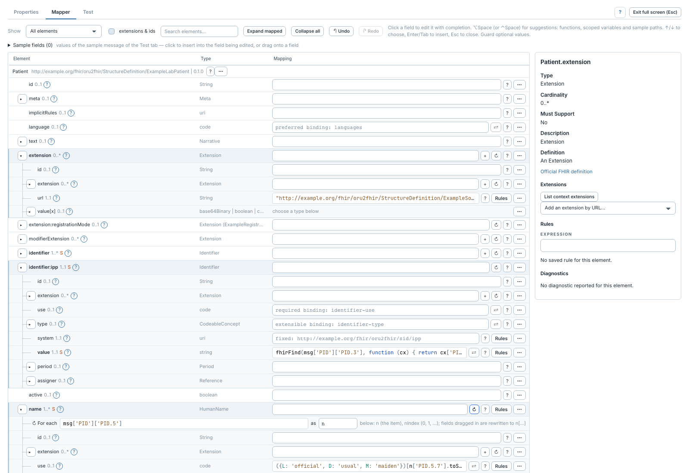

# Mapper une extension

[Manuel](../README.md) · [Profile Mapper](README.md)

## Extension déclarée dans le profil

1. Sélectionner le conteneur, par exemple **Patient**.
2. Dans l'inspecteur, choisir une **Profile extension**. La liste donne le nom
   de la slice et sa canonique.
3. Le mappeur révèle et déplie la slice.
4. Mapper sa valeur, par exemple `valueCode` avec `'routine'` dans la démo.

L'URL fixe du profil est ajoutée lorsque la valeur construit l'extension. Ne pas
l'écrire de nouveau à la main.

## Extension du contexte, absente du profil

1. Dans l'inspecteur du conteneur, cliquer **List context extensions**.
2. Choisir la canonique dans **Add context extension**.
3. L'éditeur réutilise une occurrence générique libre ou en ajoute une, puis
   renseigne son `url`.
4. Déplier `value[x]`, choisir le type adapté à la définition de l'extension et
   mapper sa valeur. Pour `ExampleSourceLabel`, choisir `valueString`.
5. Exécuter un test avec validation FHIR.

L'ajout générique n'est pas proposé si le profil ferme le slicing des extensions.
Le choix d'une URL ne vérifie pas à lui seul son contexte d'application : la
validation du résultat reste nécessaire.

## Extension d'une primitive

Quand le snapshot du profil déclare une extension sous une primitive, la déplier
et mapper sa valeur comme une extension ordinaire. L'éditeur montre le chemin
FHIR (`birthDate.extension`, par exemple), tandis que le compilateur écrit la
forme JSON FHIR `_birthDate.extension`. Pour une primitive répétée, `_given` et
`given` conservent les mêmes indices ; le résultat contient des `null` de
positionnement lorsque seules certaines valeurs portent une extension.
