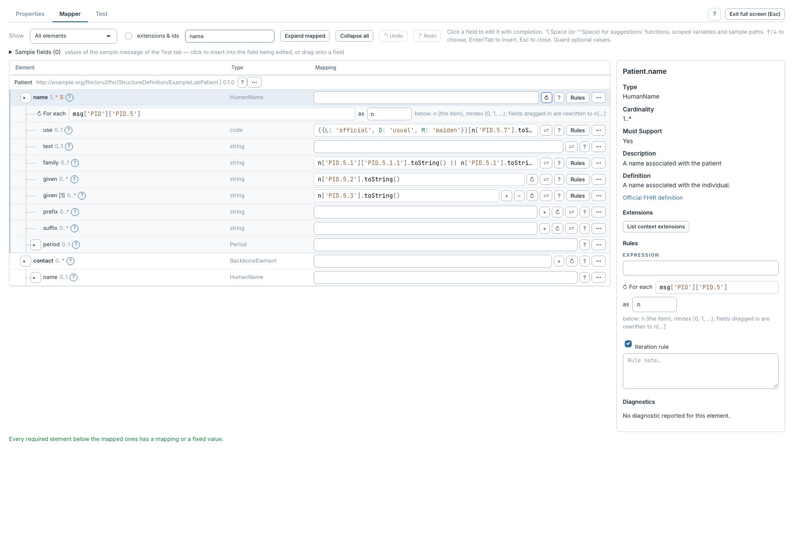

# Répéter un élément avec une itération

[Manuel](../README.md) · [Profile Mapper](README.md)

Utiliser une itération lorsque le nombre d'occurrences dépend d'une liste du
message : noms du patient, identifiants ou observations, par exemple.



1. Sur l'élément répétable, cliquer **↻** ou **Toggle iteration** dans son menu.
2. Renseigner l'expression qui retourne la liste, par exemple
   `msg['PID']['PID.5']`.
3. Choisir la variable de l'item, par exemple `n`.
4. Mapper les enfants à partir de cette variable :

```javascript
n['PID.5.1'].toString()
```

`nIndex` est l'index de l'item, à partir de zéro. La complétion propose les
variables des boucles englobantes. Les chemins source glissés ou insérés sous la
boucle sont réécrits vers la variable quand le mappeur reconnaît leur préfixe.

Une [condition](conditions.md) sur l'élément itéré s'applique à chaque item.
Désactiver la boucle avec son bouton la retire ; désactiver sa **règle** conserve
son texte mais empêche son exécution. Vérifier alors le sens des expressions qui
utilisent sa variable.

Sur une étape ressource ajoutée à un Bundle, la racine peut aussi être itérée
pour produire une ressource par item, par exemple une Observation par OBX.
Une branche déjà itérée ne propose pas **Duplicate branch**.
