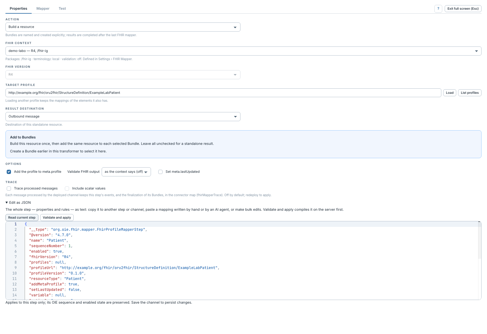
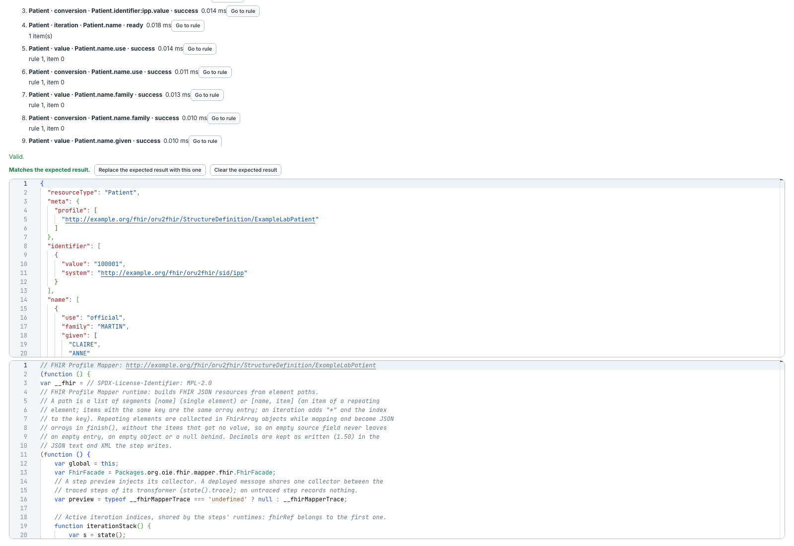

# Éditer l'étape en JSON et lire le script généré

[Manuel](../README.md) · [Profile Mapper](README.md)

## Copier ou modifier une étape complète

1. Dans **Properties**, ouvrir **Edit as JSON**.
2. **Read current step** copie l'état en cours dans l'éditeur.
3. Copier le texte pour l'archiver, ou y coller un objet d'étape complet à adapter.
4. Cliquer **Validate and apply** : le serveur compile avant l'application.
5. Relire le mapping, le tester, puis enregistrer le canal.

Ce panneau concerne l'étape entière. Les champs `mappings`, `bundleTargets` et
`samples` sont des **chaînes contenant du JSON**, et non des tableaux directs.
Ne pas transformer ces chaînes en tableaux lors d'une modification manuelle.
L'identité OIE de l'étape dans le transformeur est conservée lors de l'application.
Le [format technique](../../../reference/Specification-mapping.md) décrit les règles en détail.

## Lire le code exécuté

Dans **Test**, **Generated script** affiche le JavaScript produit par le serveur ;
**Hide the script** le referme. Il aide à comprendre une compilation ou à transmettre
un diagnostic. Modifier ce texte n'est pas une méthode d'édition du mapping :
les règles et propriétés restent sa source.

**Copy branch as JSON**, dans le menu d'une ligne, ne copie qu'un tableau de règles.
Il ne se colle pas tel quel à la place de l'objet d'étape complet de ce panneau.
