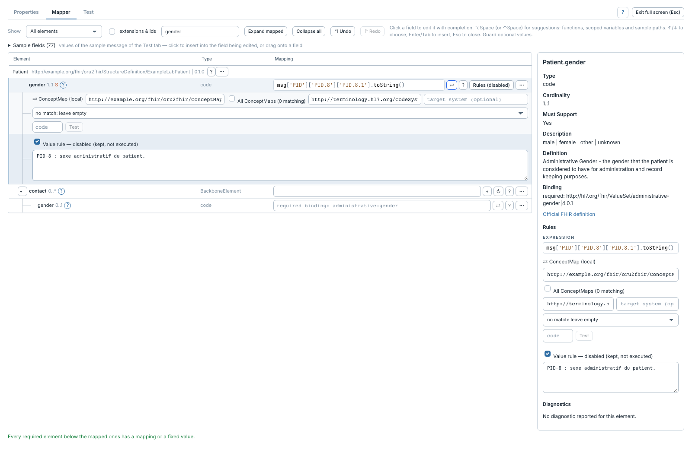

# Documenter et désactiver une règle

[Manuel](../README.md) · [Profile Mapper](README.md)

Les notes expliquent le mapping sans modifier son résultat. La désactivation
permet de suspendre une règle en gardant son contenu.

1. Cliquer **Rules** sur un élément mappé, ou sélectionner l'élément pour utiliser
   son inspecteur.
2. Saisir la note dans le champ de la règle concernée.
3. Décocher sa case d'activation pour suspendre cette règle.
4. Recocher pour la réactiver.

Un élément peut avoir plusieurs règles : valeur, condition, itération et valeur
fixe. Elles ont chacune leur note et leur activation. Désactiver la valeur
n'est pas la même opération que désactiver sa condition ou sa boucle.
Le bouton **Rules (disabled)** indique qu'au moins une de ses règles est désactivée.

Une condition désactivée laisse passer les règles situées dessous sans son filtre.
Une boucle désactivée ne fournit plus son contexte d'itération ; vérifier les
expressions qui dépendent de sa variable avant d'exécuter le mapping.

Les notes et activations sont sauvegardées avec le canal. **Undo / Redo** les
restaure pendant l'édition ; ce n'est pas un historique persistant des versions
du canal. Pour activer ou désactiver toute une branche, utiliser son
[menu d'actions](branches.md).
