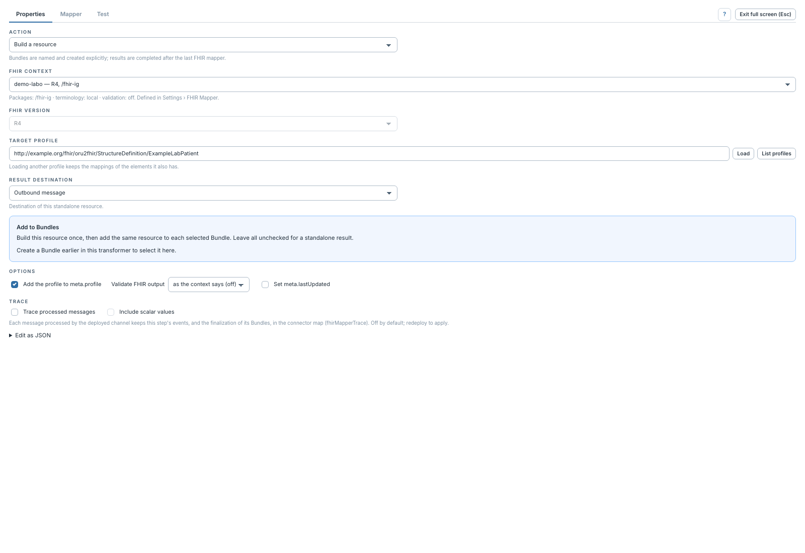

# Configurer l'étape et charger un profil

[Manuel](../README.md) · [Profile Mapper](README.md)

Choisir l'onglet **Properties**.

1. Choisir **Build a resource** dans **Action**.
2. Sélectionner un **FHIR context** existant. Il fournit la version FHIR, les
   packages et la terminologie. La version devient non modifiable dans l'étape.
3. Dans **Target Profile**, saisir la canonique du profil ou un type de base,
   par exemple `Patient`.
4. **List profiles** propose les profils des packages. Cliquer **Load** pour
   lire le profil choisi et construire l'arbre.
5. Passer dans **Mapper** pour écrire les règles.

Sans contexte, renseigner la **FHIR Version**, les **Profile Packages** et,
si nécessaire, le **Terminology Server** dans l'étape. Les chemins de fichiers,
dossiers et packages sont ceux du serveur, séparés par `;` dans ce champ.
Un contexte partagé évite de répéter ces réglages dans chaque étape.

Charger un autre profil conserve les mappings des éléments qu'il possède aussi.
Les éléments introuvables sont signalés ; lire ce bilan avant de sauvegarder.
Un changement de version du profil peut demander une vérification des mappings.

Le résultat peut être autonome ou alimenter des [Bundles](bundles-et-references.md).
Sa [destination et sa validation](sortie-et-validation.md) se règlent séparément.
