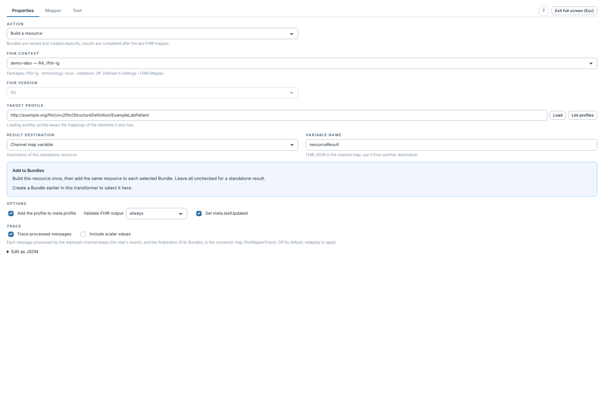

# Destination du résultat et validation

[Manuel](../README.md) · [Profile Mapper](README.md)

Ces réglages se trouvent dans **Properties**.

Pour une ressource autonome, **Result destination** propose :

- **Outbound message** : publier dans le message de sortie ; le modèle sortant
  `tmp` est utilisé s'il existe, sinon `msg`.
- **Channel map variable** : publier le JSON FHIR dans une variable nommée,
  à réutiliser par une destination suivante.

Pour une ressource ajoutée à des Bundles, la publication finale dépend de leurs
étapes de déclaration. Un Bundle peut être publié dans le message et un autre
dans une variable, comme `bundleDocument` dans la démo.

## Choisir la validation

| Mode | Comportement |
|---|---|
| **as the context says** | Hériter de la politique du contexte choisi. |
| **always** | Valider le résultat de cette étape. |
| **off** | Ne pas demander cette validation au mappeur. |

Pour une ressource d'un Bundle, **Validate this preview** concerne l'aperçu :
la validation finale se configure sur chaque Bundle. Une erreur FHIR peut arrêter
le message. Si le datatype FHIR valide aussi la sortie du canal, cette validation
est distincte de celle réglée dans le mappeur.

**Add the profile to meta.profile** inscrit la canonique du profil cible dans
la ressource. **Set meta.lastUpdated** ajoute sa date de dernière mise à jour.
**Trace processed messages** active la trace pour les messages futurs après
redéploiement ; voir [la procédure](trace-messages.md).

La capture montre un contexte de démonstration dont la politique est `off`,
mais une étape réglée explicitement sur `always`. Ce dernier choix impose la
validation pour cette étape.
