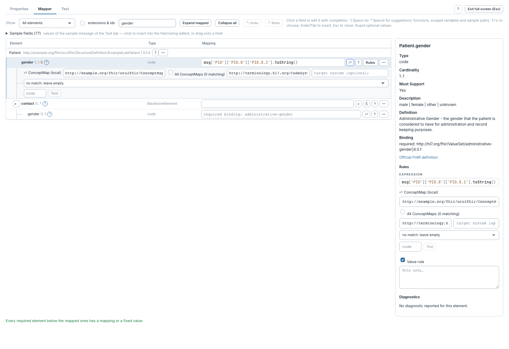

# Naviguer dans le studio

[Manuel](../README.md) · [Profile Mapper](README.md)

**Mapper** affiche l'arbre du profil. **Full screen** agrandit l'éditeur ;
**Exit full screen** ou Échap le referme, lorsque aucun champ ou menu ne traite
encore cette touche.

Cliquer le nom d'un élément, l'activer au clavier avec Entrée ou entrer dans son
champ pour le sélectionner. L'inspecteur suit cette sélection et affiche les
informations disponibles : type, cardinalité, Must Support, slice, description,
définition, binding, valeur fixe et exemples du profil. **Official FHIR definition**
ouvre la définition de la version FHIR utilisée.

| Commande | Utilité |
|---|---|
| **Search elements** | Chercher un chemin ou un nom ; les branches correspondantes s'ouvrent. |
| **Show** | Afficher tous les éléments, seulement les éléments requis/Must Support, ou les éléments mappés. |
| **extensions & ids** | Montrer aussi les extensions génériques et identifiants techniques masqués. |
| **Expand mapped** | Déplier les parents des éléments mappés. |
| **Collapse all** | Replier l'arbre. |
| **Undo / Redo** | Annuler ou rétablir les modifications du mapping pendant l'édition. |
| **?** près des onglets | Lire l'aide de l'onglet actif. |

`1..*` signifie au moins une occurrence ; `0..1` une occurrence facultative.
Le badge **S** signifie Must Support. Une ligne rouge signale un diagnostic du
dernier test ou de la compilation.

**Alt+↑/↓** déplace le focus entre les champs de l'arbre ; **Alt+←/→** replie ou
déplie l'élément. **Maj+F10** ouvre son menu d'actions.

L'inspecteur passe sous l'arbre dans une zone étroite. La recherche est bornée
pour éviter les parcours récursifs trop coûteux ; si elle est partielle,
sélectionner la branche visée ou préciser le texte recherché.
