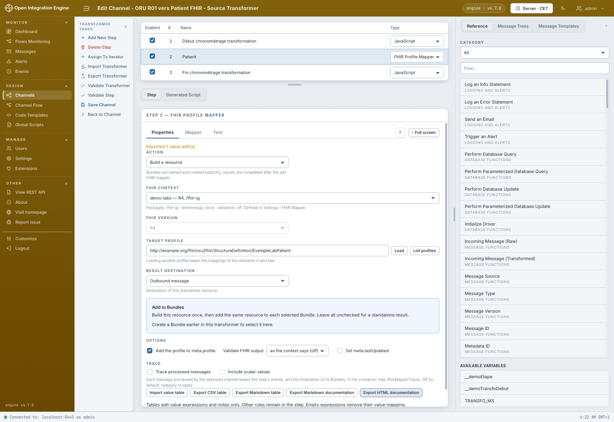
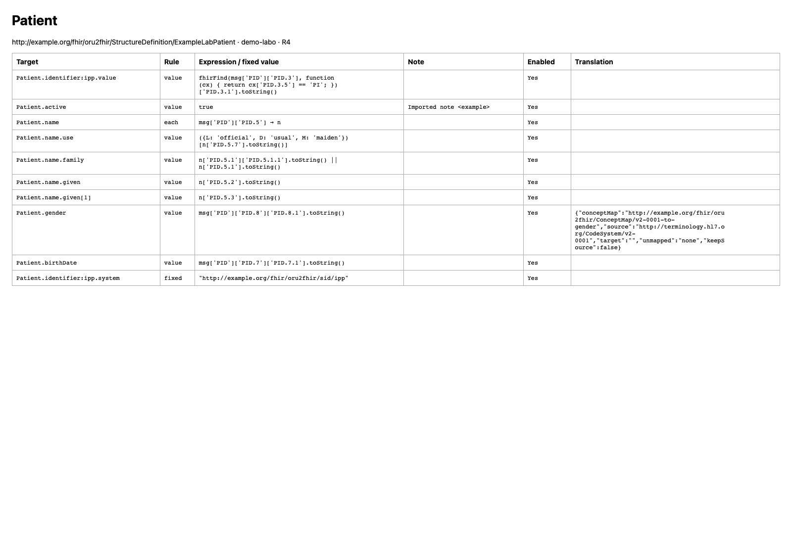

# Importer un tableau et exporter la documentation

[Manuel](../README.md) · [Profile Mapper](README.md)

Les boutons se trouvent dans **Properties / Propriétés**, au-dessus de l’éditeur JSON.



## Modifier des valeurs en tableau

**Export CSV table** ou **Export Markdown table** produit les expressions de
valeur et leurs notes. Les noms de colonnes restent `key`, `expression`, `note`,
quelle que soit la langue du plugin :

```csv
key,expression,note
Patient.active,true,Patient actif
Patient.gender,"msg.gender || 'unknown'",Code de sexe
```

1. Charger le profil et préparer les occurrences nécessaires dans l’arbre.
2. Modifier le tableau ; conserver les clés cibles exactes du profil.
3. Cliquer **Import value table**, puis choisir un fichier `.csv` ou `.md`.
4. Relire le mapping, le tester, puis enregistrer le canal pour conserver l’import.

Toutes les lignes sont vérifiées avant modification. Une cible inconnue,
un doublon, une cible choix non résolue ou une ligne invalide rejette tout
l’import. Une expression vide supprime son mapping de valeur. Une note vide
efface la note de cette valeur. Les conditions, itérations, traductions et
activations existantes sont conservées ; les nouveaux mappings reçoivent leur
ID lors de la compilation. **Undo** annule tout l’import en une opération.
L’import ne vérifie pas la syntaxe JavaScript : utiliser le contrôle et le test.

Le CSV utilise la virgule et les guillemets CSV standards pour les virgules,
guillemets ou retours à la ligne. Le Markdown utilise une table avec ces mêmes
colonnes ; l’export échappe les barres verticales, antislashs et retours à la
ligne. Les cibles doivent déjà être accessibles dans l’arbre chargé. Les
conditions et itérations ne s’importent pas comme des expressions de valeur.
Pour échanger toute l’étape, utiliser [l’édition JSON](json-et-script.md).

## Documenter le mapping

**Export Markdown documentation** et **Export HTML documentation** exportent
les règles, y compris conditions, itérations, valeurs fixes, notes, activation
et traduction. Le HTML est un document autonome consultable dans un navigateur.
Les expressions sont du texte ; elles ne s’exécutent pas dans ce document.



Cette documentation est un instantané de l’étape, pas un format de réimport.
Les contextes partagés restent définis sur le serveur.
