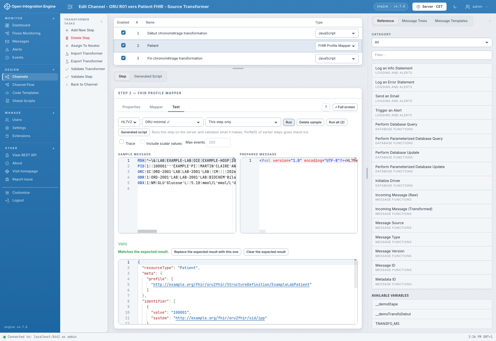
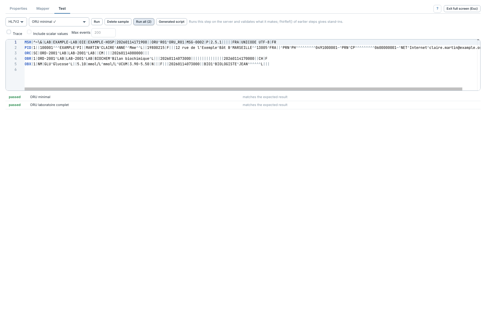

# Tester une étape et conserver des exemples

[Manuel](../README.md) · [Profile Mapper](README.md)

L'onglet **Test** exécute l'étape sur le serveur, sans déployer le canal. Le droit
`Test FHIR mapper steps` est nécessaire.

1. Choisir le type d'entrée : **HL7V2**, **XML**, **JSON** ou **RAW**.
2. Coller le message dans **Sample message**, ou choisir un exemple de la liste
   **Sample**. Le template entrant du transformeur sert de point de départ.
3. Cliquer **Run**.
4. Lire les erreurs, le statut de validation et le résultat coloré.

Après l'exécution, **Prepared message** affiche le message sérialisé transmis
au mapping, à droite de l'exemple ou dessous si la zone est étroite. Pour une
entrée HL7 v2, il s'agit du XML produit par le sérialiseur de l'aperçu. Cette vue
reste disponible si une règle échoue après la préparation de l'entrée.
Elle ne simule pas les JavaScriptSteps ou le nettoyage d'un connecteur : fournir
un exemple déjà préparé lorsque ces traitements sont nécessaires.

Les zones exemple, message préparé et résultat partagent la hauteur disponible.
Le défilement du code reste dans chaque éditeur, sans second défilement du panneau.
**Full screen** agrandit l'espace ; les traces et diagnostics restent consultables.

`Valid.` signifie que la validation demandée n'a pas rapporté d'erreur.
`FHIR validation disabled.` signifie qu'elle n'a pas été exécutée.

## Enregistrer et rejouer des exemples

- Choisir l'exemple non enregistré, puis **Save as sample** et donner un nom.
- Pour un exemple enregistré, les modifications du message restent dans cet
  exemple. **Delete sample** le retire de l'étape.
- Enregistrer le canal pour partager ces exemples avec les autres utilisateurs.
- **Run all** rejoue tous les exemples enregistrés. Cliquer une ligne pour
  reprendre l'exemple correspondant.

Un résultat `passed` peut signifier qu'un exemple s'exécute sans erreur **sans
résultat attendu**. La colonne de détail le précise. Pour contrôler le contenu,
fixer un [résultat attendu](comparaison.md).

L'exemple non enregistré est mémorisé dans ce navigateur, par canal et
transformeur ; il n’est pas partagé. **Run all** respecte le périmètre enregistré
avec chaque exemple : étape seule par défaut, ou [aperçu multi-étapes](apercu-multi-etapes.md).
Les exemples peuvent aussi être [rejoués par outil](../../../demo/Rejeu-tests.md).
