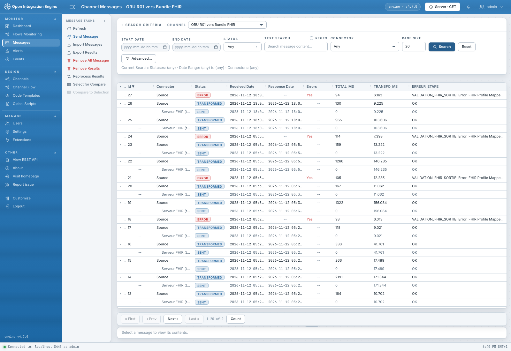
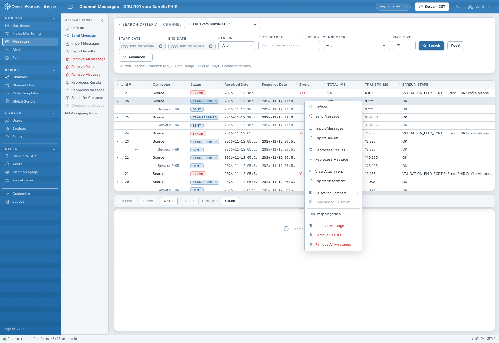
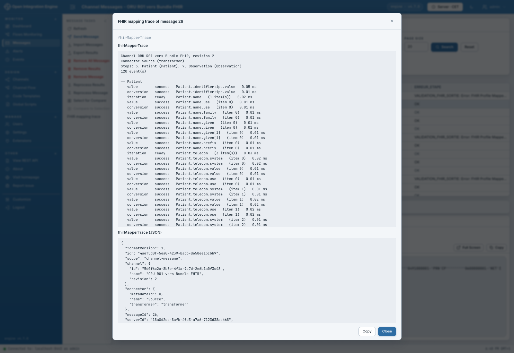

# Lire la trace d'un message traité

[Manuel](../README.md) · [Profile Mapper](README.md)

Cette trace décrit le traitement réel d'un canal déployé, avec ses références,
la finalisation des Bundles et leur publication.

1. Dans **Properties** des étapes Profile Mapper à observer, cocher
   **Trace processed messages**.
2. Laisser **Include scalar values** décoché si le contenu des valeurs ne doit
   pas être conservé.
3. Enregistrer et redéployer le canal.
4. Envoyer un **nouveau** message. Les anciens messages n'acquièrent pas de trace
   rétroactivement.
5. Depuis **Dashboard**, sélectionner le canal puis **View Messages**, ou ouvrir
   son navigateur dans **Messages**. Lancer **Search**, sélectionner le message
   et son connecteur, puis ouvrir son menu par clic droit.
6. Choisir **FHIR mapping trace**.

La fenêtre présente une lecture textuelle et le JSON des traces trouvées pour
le message ou le connecteur sélectionné. On y retrouve les étapes, les phases,
les statuts, les durées et, lorsqu'elles sont tracées, les références et sorties.
La conservation des maps du message doit être activée dans la politique de
stockage du canal.

Si l'action indique qu'aucune trace n'existe, vérifier l'activation, le
redéploiement, la date du message et la conservation de ses maps. Une trace
tronquée n'est pas une preuve d'absence d'événements ultérieurs.

Pour un diagnostic de saisie sans déploiement, utiliser plutôt la
[trace d'un test](diagnostics-et-traces.md). FML ne fournit pas actuellement
cette trace détaillée par règle.
