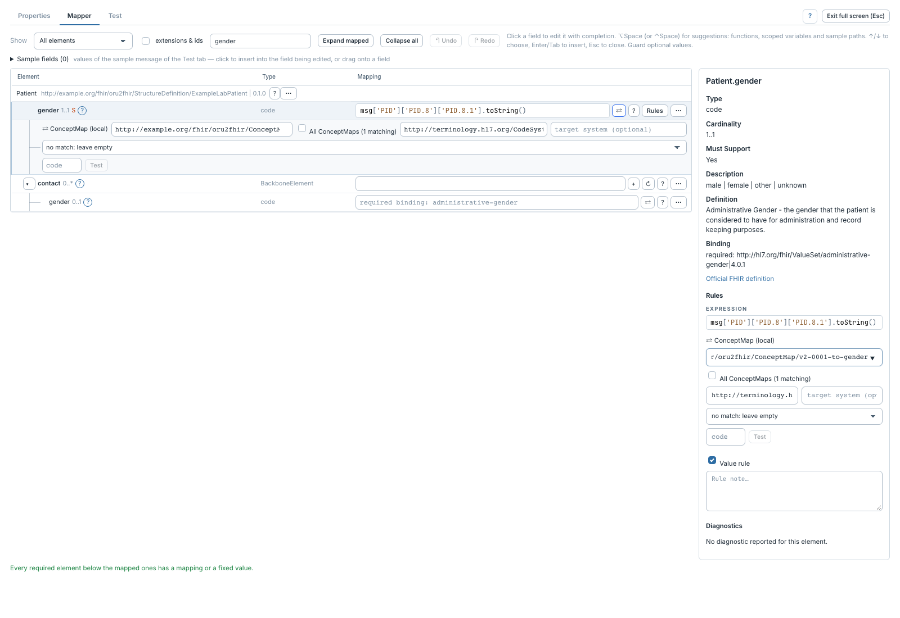

# Traduire un code avec une ConceptMap

[Manuel](../README.md) · [Profile Mapper](README.md)

La traduction convertit les codes du message vers ceux attendus par FHIR, par
exemple `F` vers `female`.

1. Mapper d'abord l'expression du code source sur l'élément cible.
2. Cliquer **⇄** ou **Toggle translation**.
3. Choisir la canonique de la **ConceptMap**.
4. Renseigner le système source et, si nécessaire, le système cible.
5. Choisir le comportement lorsqu'aucune correspondance n'existe.

| Choix sans correspondance | Effet |
|---|---|
| `leave empty` | Ne pas produire de valeur traduite. |
| `keep the source code` | Conserver le code source. |
| `fixed value` | Utiliser la valeur de repli fournie. |
| `expression` | Évaluer le repli avec `code` et `system` disponibles. |
| `error` | Signaler l'absence de traduction comme une erreur. |

Les propositions sont filtrées par les systèmes source/cible et, sans système
cible explicite, par le binding de l'élément. Les systèmes des codes développés
du binding aident à identifier les maps pertinentes. **All ConceptMaps** affiche
la liste complète si les métadonnées sont insuffisantes. Le choix courant reste
inchangé ; l'éditeur ne déduit pas une table HL7 du texte de l'expression.

Saisir un code dans le petit champ de test, puis **Test** pour essayer uniquement
la traduction. Ce test ne rejoue pas le mapping complet. Pour un CodeableConcept,
l'option de conservation du codage source permet de garder aussi ce codage.

Un serveur terminologique vide ou `n/a` utilise les ConceptMaps des packages.
Une URL utilise le serveur distant ; ses paramètres se règlent dans le
[contexte](../settings/terminologie.md) ou dans l'étape sans contexte.
