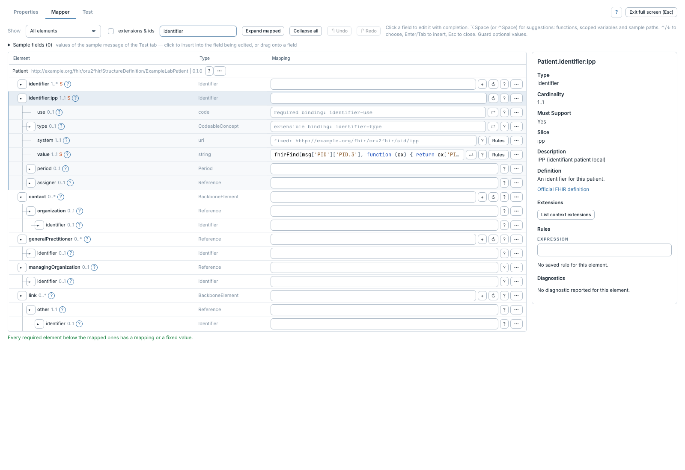
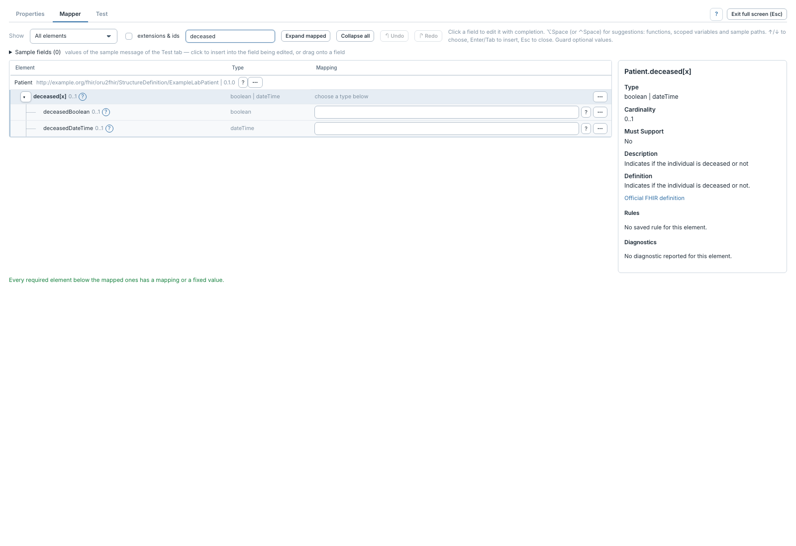

# Types choix, slices et valeurs fixes

[Manuel](../README.md) · [Profile Mapper](README.md)

Un profil impose des types et peut découper une collection en **slices**, c'est-à-dire
des occurrences identifiées par des contraintes particulières.

Dans la démo, `identifier:ipp` représente l'identifiant patient local. Mapper
`identifier:ipp.value` crée cette occurrence ; la valeur fixe de `system` est
ajoutée automatiquement quand la structure correspondante est construite.
L'inspecteur et les champs vides indiquent les contraintes **fixed** et **pattern**
disponibles. Il n'est pas nécessaire de recopier leur valeur dans une expression.

## Choisir un type

Un élément `[x]` offre plusieurs types. Déplier, par exemple, `deceased[x]`, puis
mapper `deceasedBoolean` pour produire un booléen ou `deceasedDateTime` pour une
date/heure. Le parent `[x]` ne reçoit pas d'expression lui-même.

Pour une [extension](extensions.md), le profil peut restreindre `[x]` à un seul
type, par exemple `valueCode` : celui-ci apparaît directement dans l'arbre.

Les sous-slices apparaissent avec leur nom complet, par exemple
`component:panel/detail`. Le mappeur applique la déclaration de slicing la plus
proche : une sous-slice peut donc employer un autre discriminant que sa slice
parente.

Le mappeur sait matérialiser :

- `value` et `pattern` lorsque le profil fournit une valeur fixe ou un pattern ;
- `type` sur un choix `[x]`, grâce au nom JSON du type choisi ;
- `profile` pour une ressource `contained` contrainte par un profil concret ;
- `exists` quand le profil interdit le chemin (`max: 0`) ou quand ce chemin est
  lui-même mappé.

Une slice fondée sur un discriminant que le JSON produit ne peut pas démontrer,
par exemple `profile($this)` sur une `Reference`, est refusée à la compilation
avec le chemin et le type du discriminant. Mapper explicitement le discriminant
quand c'est possible ou employer un profil cible plus concret. La validation
FHIR reste le contrôle final des contraintes du profil.

## Ressource contained

Une entrée `contained` n'est proposée que si son type `Resource` possède une
canonique de profil. Déplier cette entrée puis mapper ses champs. Le mappeur
ajoute automatiquement le `resourceType` du profil chargé. Un `contained`
générique sans profil reste masqué : son type de ressource serait ambigu.
