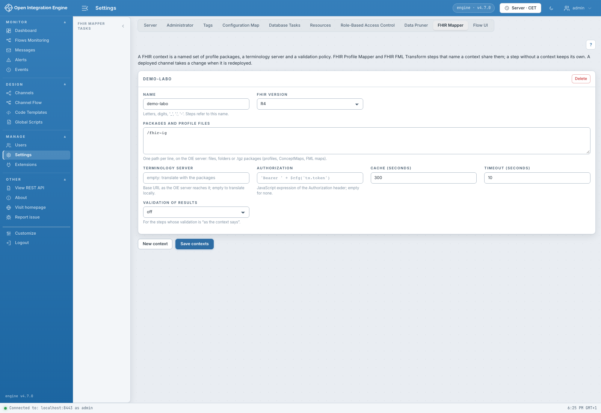

# Settings › FHIR Mapper

[Accueil du manuel](../README.md)

Ce panneau administre les **contextes FHIR nommés** du serveur. Ils évitent de
répéter les emplacements et les réglages dans chaque étape.

- [Créer, nommer, enregistrer ou supprimer un contexte](contextes.md)
- [Configurer les packages et fichiers](packages.md)
- [Régler la terminologie](terminologie.md)
- [Choisir la validation et appliquer les changements](validation.md)

Ouvrir **Settings**, puis l'onglet **FHIR Mapper**. **Save contexts** enregistre
les contextes du plugin ; le bouton Save général de Settings n'est pas le bouton
de cette procédure. Le droit `Manage FHIR mapper settings` est nécessaire pour
les modifier. **?** ouvre l'aide du panneau.

Les étapes choisissent un contexte par son nom. Sans contexte, leurs propriétés
locales restent utilisées. La prise en compte côté traitement nécessite le
redéploiement des canaux concernés.

Le panneau n'importe pas un package depuis le poste de l'utilisateur : les
fichiers doivent déjà être accessibles au serveur. Il ne propose pas encore de
bouton de rechargement de catalogue par contexte ni de gestionnaire graphique
des dépendances des packages.
