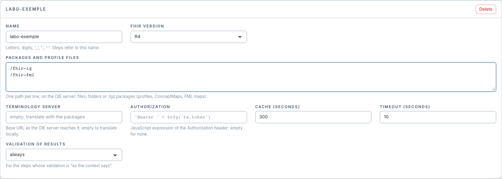

# Créer et maintenir un contexte

[Manuel](../README.md) · [Settings](README.md)

1. Ouvrir **Settings › FHIR Mapper**.
2. Cliquer **New context**.
3. Donner un **Name** stable, par exemple `labo-exemple`.
4. Choisir la **FHIR version** et renseigner ses packages et options.
5. Cliquer **Save** dans *FHIR Mapper Tasks*.
6. Choisir ce nom dans **FHIR context** sur les étapes concernées, puis enregistrer
   et redéployer leurs canaux.

Le nom accepte lettres, chiffres, `_`, `.`, `-`. Il doit être unique sur le
serveur. Les étapes référencent ce nom : renommer un contexte demande de mettre
à jour leurs sélections. Une étape qui nomme un contexte absent ne récupère pas
silencieusement une autre configuration.

**Delete** retire le contexte de la liste d'édition. La suppression devient
persistante avec **Save** (*FHIR Mapper Tasks*). Vérifier les étapes qui l'utilisent avant de
l'enregistrer ; leurs canaux devront être adaptés et redéployés.

Le contexte de la capture est un exemple de saisie non enregistré. Les contextes
sont des réglages du serveur ; exporter un canal ne transporte pas à lui seul
les fichiers et réglages de contexte requis vers un autre serveur.
