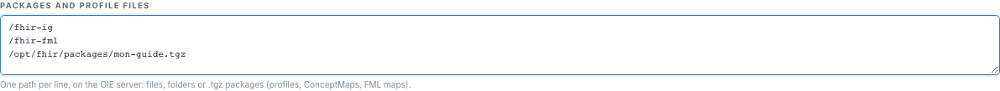

# Déclarer les packages et fichiers FHIR

[Manuel](../README.md) · [Settings](README.md)

Le champ **Packages and profile files** contient **un chemin serveur par ligne**.



Exemples de contenu :

```text
/fhir-volume/ig
/fhir-volume/fml
/opt/fhir/packages/mon-guide.tgz
```

L'image de démonstration fournit aussi deux chemins vérifiés au build :

```text
/fhir-packages/hl7.fhir.fr.core-2.2.0.tgz
/fhir-packages/hl7.fhir.eu.laboratory-2.0.0.tgz
```

Ils alimentent respectivement les contextes `fr-core-2.2.0` et
`eu-laboratory-2.0.0` installés dans le panneau Settings de la démo.

Les emplacements peuvent fournir profils StructureDefinition, ValueSets,
ConceptMaps, StructureMaps et fichiers FML. Un dossier est utile pour les
ressources d'un guide ; un `.tgz` fournit un package. L'accès se fait depuis le
processus OIE : un chemin valide sur votre ordinateur peut être absent du
conteneur ou du serveur.

1. Mettre les fichiers à disposition du serveur, avec ses droits de lecture.
2. Ajouter leurs chemins dans le contexte et cliquer **Save** (*FHIR Mapper Tasks*).
3. Revenir dans les étapes et charger les profils ou maps nécessaires.
4. Tester, enregistrer et redéployer les canaux concernés.

Le panneau n'envoie aucun fichier local au serveur. Il ne résout pas
automatiquement toutes les dépendances d'un package absent : fournir aussi les
ressources importées requises. En cas de profil introuvable, vérifier sa
canonique, sa version FHIR et ses emplacements.

Après modification de fichiers déjà chargés, les catalogues peuvent rester en
mémoire. Le [Reload FML](../fml/configurer.md) recharge les maps ; pour un profil
persistant en cache, suivre la procédure de rechargement serveur prévue par
l'exploitation, puis rouvrir l'étape. Le panneau Settings ne possède pas encore
ce bouton pour le catalogue des profils.
