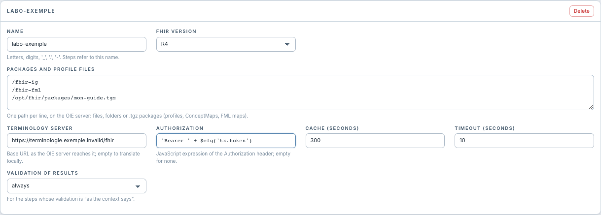

# Configurer la terminologie

[Manuel](../README.md) · [Settings](README.md)

Les paramètres de terminologie du contexte sont utilisés par le Profile Mapper
qui le sélectionne.

| Champ | Saisie et effet |
|---|---|
| **Terminology server** | URL de base accessible par le serveur OIE ; vide ou `n/a` pour utiliser les ConceptMaps locales des packages. |
| **Authorization** | Expression JavaScript de l'en-tête HTTP, vide si aucun ; par exemple `'Bearer ' + $cfg('tx.token')`. |
| **Cache (seconds)** | Durée de réutilisation des réponses ; `0` désactive cette réutilisation. |
| **Timeout (seconds)** | Délai d'attente du serveur, en secondes. |

Enregistrer avec **Save contexts**, puis redéployer les canaux pour modifier les
traitements futurs. Tester une traduction dans l'éditeur avant de déployer :
le code, son système et la ConceptMap doivent être cohérents.

L'Authorization est une expression, pas seulement la valeur brute d'un jeton.
La capture n'affiche aucun secret réel. Référencer une valeur de configuration
plutôt que recopier un jeton dans un exemple destiné à être partagé.

Le `translate()` FML utilise les ConceptMaps des emplacements de sa map ; ne pas
supposer que renseigner ici un serveur distant change ce mécanisme FML.
