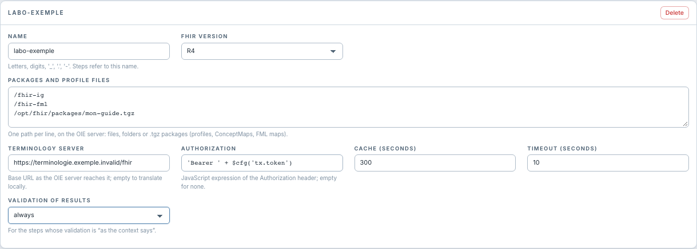

# Choisir la validation et appliquer les réglages

[Manuel](../README.md) · [Settings](README.md)

**Validation of results** propose `always` ou `off` pour le contexte.

Pour le **Profile Mapper**, cette politique est utilisée par les étapes réglées
sur **as the context says**. Une étape peut choisir explicitement `always` ou
`off`. Une validation désactivée ne permet pas de conclure que la ressource est
conforme ; le résultat du test le signale.

Pour les ressources ajoutées à un Bundle, le réglage de l'étape ressource contrôle
son aperçu ; la validation finale se règle sur chaque Bundle.

Pour **FHIR FML Transform**, utiliser la case **Validate the result** de l'étape.
Dans la version actuelle, elle demeure indépendante du mode d'héritage présenté
par le Profile Mapper ; voir [les réglages FML](../fml/sortie.md).

## Quand le changement prend-il effet ?

1. **Save contexts** enregistre les réglages sur le serveur.
2. Rouvrir ou actualiser les étapes pour vérifier leur configuration affichée.
3. Enregistrer les canaux si leurs propriétés ont été changées.
4. **Redéployer** les canaux pour qu'ils utilisent les réglages au traitement.
5. Envoyer un nouveau message et vérifier son résultat.

La validation du datatype FHIR en sortie du canal est une autre configuration.
La désactiver dans le mappeur ne désactive pas celle du datatype, et inversement.
Le panneau ne modifie pas rétroactivement les messages déjà traités.
