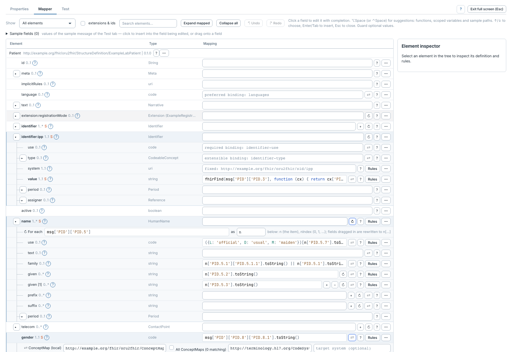

# FHIR Profile Mapper

[Accueil du manuel](../README.md)

Le Profile Mapper construit une ressource FHIR à partir du message courant et
d'un profil cible. Une étape peut aussi déclarer un Bundle ; les étapes suivantes
y ajoutent leurs ressources.

## Préparer et saisir

- [Configurer l'étape et charger un profil](profil.md)
- [Naviguer dans le studio](studio.md)
- [Écrire les expressions et utiliser les champs source](expressions.md)
- [Types choix, slices et valeurs fixes](types-et-slices.md)
- [Répéter un élément avec une itération](iterations.md)
- [Appliquer une condition](conditions.md)
- [Traduire un code avec une ConceptMap](traductions.md)
- [Mapper une extension](extensions.md)

## Organiser le mapping

- [Menu d'actions, occurrences et duplication](branches.md)
- [Notes et activation des règles](notes-et-activation.md)
- [Bundles, requêtes et références entre ressources](bundles-et-references.md)
- [Destination du résultat et validation](sortie-et-validation.md)
- [Éditer en JSON et lire le script généré](json-et-script.md)
- [Importer des tableaux et exporter la documentation](tableaux-et-documentation.md)

## Vérifier et diagnostiquer

- [Tests et exemples enregistrés](tests-et-exemples.md)
- [Aperçu multi-étapes](apercu-multi-etapes.md)
- [Rejeu par outil](../../Rejeu-tests.md)
- [Résultat attendu et comparaison](comparaison.md)
- [Diagnostics et trace d'un test](diagnostics-et-traces.md)
- [Trace d'un message traité](trace-messages.md)

L’aperçu peut tester une étape isolée ou les Profile Mapper du même transformeur.
Les autres étapes et les transports demandent un essai déployé. Les sous-slices,
les extensions de primitives et les ressources `contained` contraintes par un
profil concret sont prises en charge ; les limites des discriminants sont
détaillées dans [Types choix, slices et valeurs fixes](types-et-slices.md).
