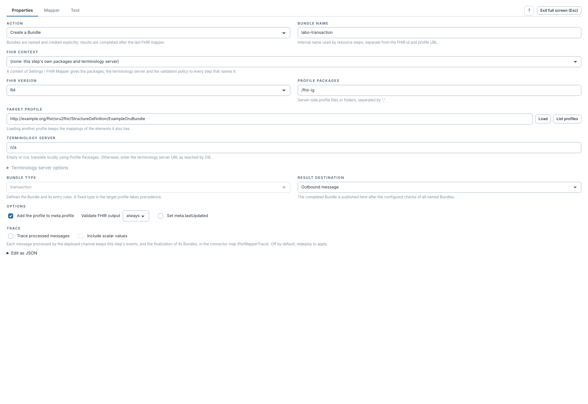
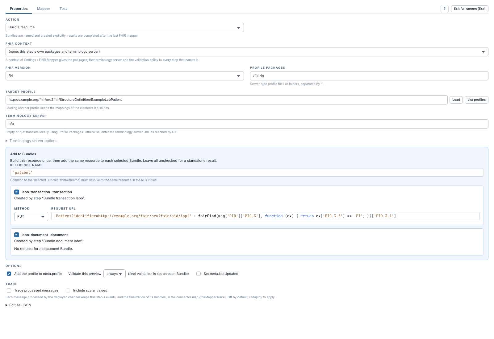
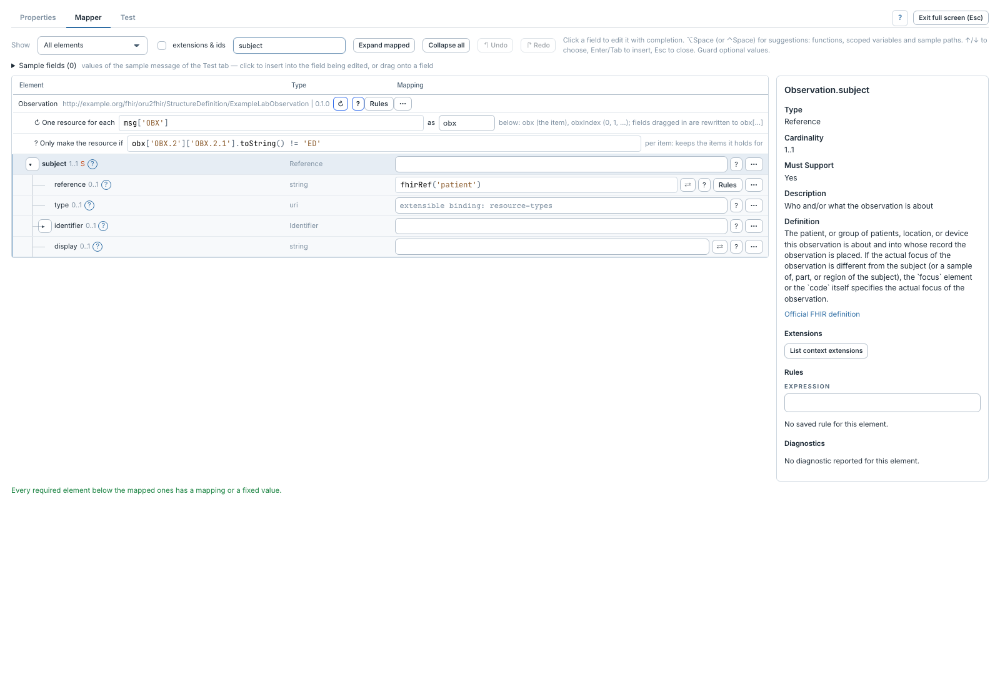

# Bundles, requêtes et références

[Manuel](../README.md) · [Profile Mapper](README.md)

Un Bundle est déclaré par une étape dédiée, placée **avant** les étapes qui
produisent ses ressources dans le même transformeur.

## Déclarer un Bundle



1. Dans **Properties**, choisir **Create a Bundle**.
2. Donner un **Bundle Name**, par exemple `labo-transaction` : c'est son nom interne.
3. Charger le profil Bundle cible et choisir son **Bundle Type** si le profil
   ne fixe pas déjà ce type.
4. Choisir la destination du résultat final : message sortant ou variable de
   Channel Map.

## Ajouter une ressource à un ou plusieurs Bundles



Dans une étape **Build a resource**, ouvrir **Add to Bundles** et cocher les
Bundles voulus. La ressource est construite une fois, puis ajoutée à chacun.
Une déclaration doit être activée et située plus haut dans ce transformeur.
Aucun Bundle coché signifie un résultat autonome.

Pour `transaction` et `batch`, choisir **Method**, **Request URL** et, pour une
création POST conditionnelle, **If-None-Exist**. Les champs d'URL et de condition
sont des expressions JavaScript. Une URL vide laisse le mappeur déterminer la
cible à partir du type et, si nécessaire, de l'ID. Un Bundle `document` ou
`collection` n'a pas de requête HTTP sur chaque entrée.

## Référencer une ressource



Définir **Reference Name**, par exemple `'patient'`, sur l'étape Patient.
Dans une autre étape du même ensemble de Bundles, utiliser :

```javascript
fhirRef('patient')
```

Le nom est distinct du FHIR `id` et du **Bundle Name**. L'expression retourne la
référence réservée à la ressource ; ne pas construire son UUID à la main.
La complétion propose les références nommées d'autres étapes du transformeur.

Le Bundle est finalisé après les étapes de mapping. Un aperçu d'étape simule les
références : seul un essai du **canal déployé** vérifie les identités, références
et sorties finales de tous les Bundles.
