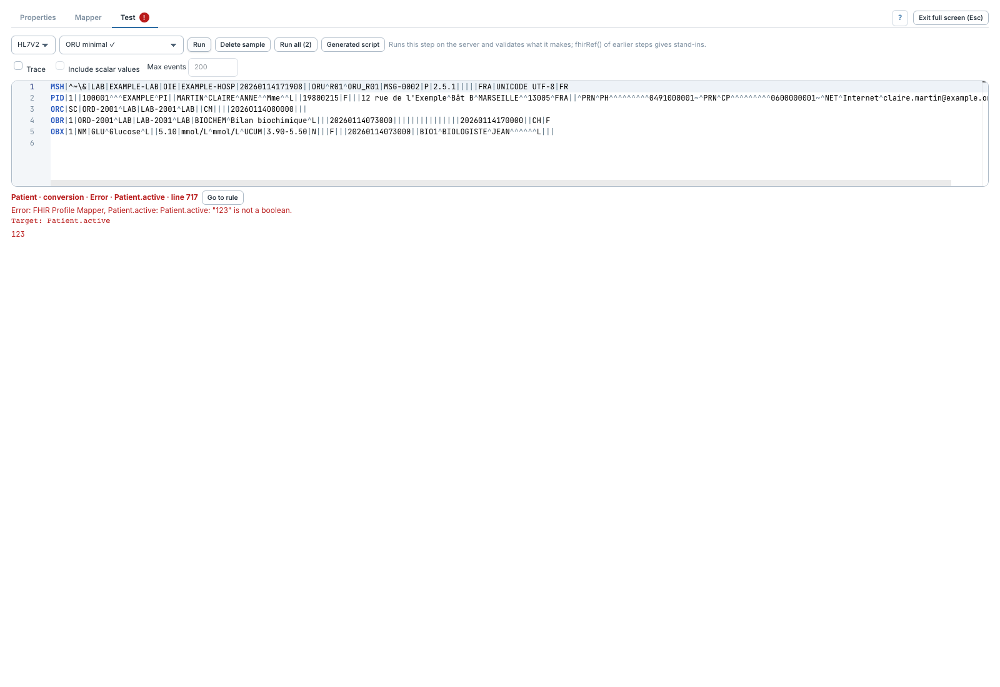
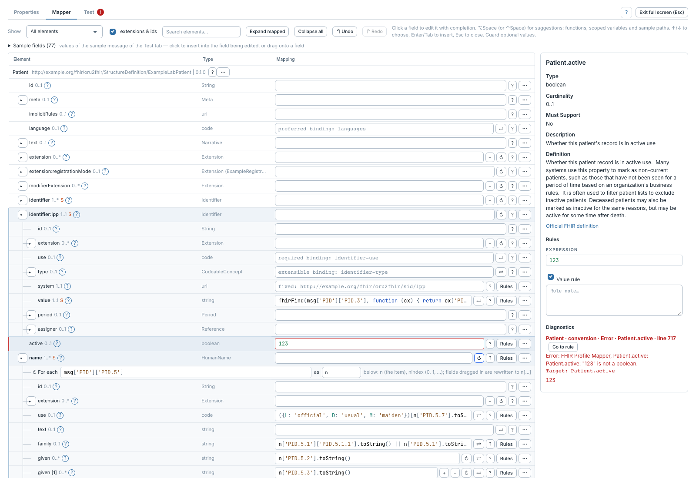
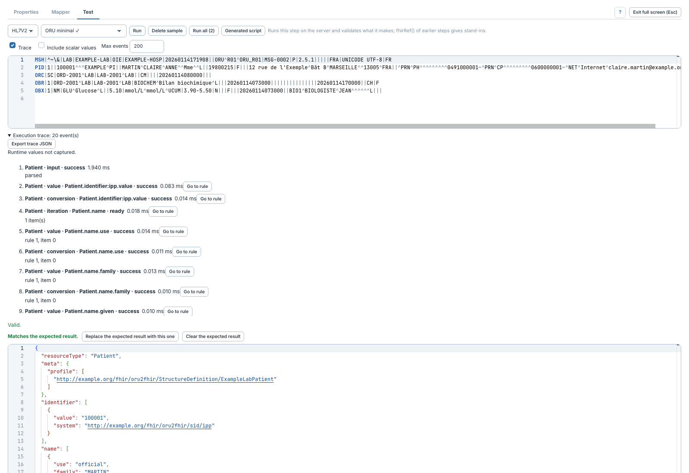

# Comprendre une erreur et tracer un test

[Manuel](../README.md) · [Profile Mapper](README.md)

## Revenir à la règle en erreur

Le diagnostic indique, selon le cas, le chemin cible, la phase, le message et
l'expression concernée. **Go to rule** ouvre **Mapper**, sélectionne l'élément,
efface la recherche qui pourrait le masquer et révèle son champ.

L'inspecteur affiche les diagnostics de l'élément sélectionné. Corriger puis
relancer le test. Dans cet exemple volontairement invalide, `123` ne peut
pas devenir un booléen pour `Patient.active`. Un nombre quelconque n'est pas un booléen ;
utiliser une expression qui retourne `true`, `false` ou une valeur convertible.

## Observer l'exécution

1. Dans **Test**, cocher **Trace**.
2. Régler **Max events** si nécessaire, puis **Run**.
3. Ouvrir **Execution trace** pour lire conditions, itérations, conversions,
   traductions et statuts. Les événements liés à une règle proposent **Go to rule**.
4. **Export trace JSON** télécharge la trace structurée.

Les valeurs scalaires ne sont pas capturées par défaut. **Include scalar values**
les ajoute explicitement et peut donc exposer le contenu du message dans la
trace et son export. Le désactiver avant de partager une trace sans ces valeurs.
**Max events** va de 1 à 1 000 ; la trace est marquée comme tronquée si une limite
est atteinte. Ces options appartiennent au test et ne sont pas enregistrées
comme activation de la trace des messages déployés.

Une trace de test observe une étape isolée ; pour les références et Bundles
réels, utiliser la [trace d'un message traité](trace-messages.md).
