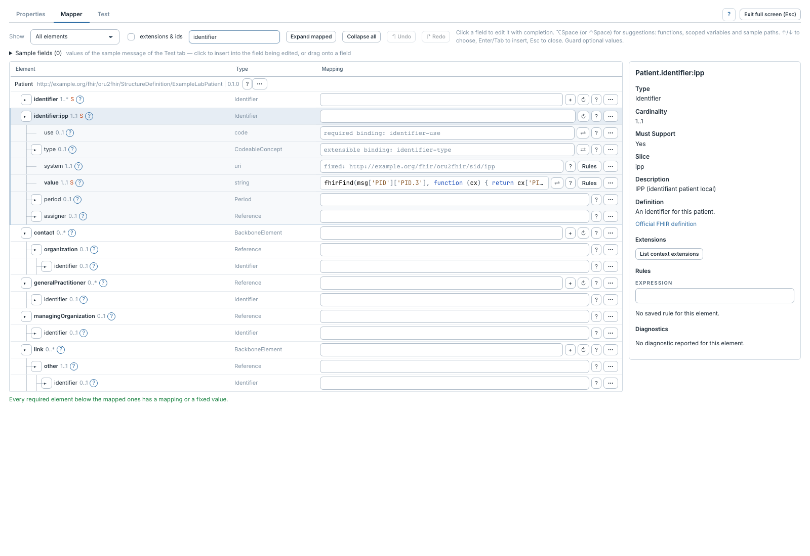
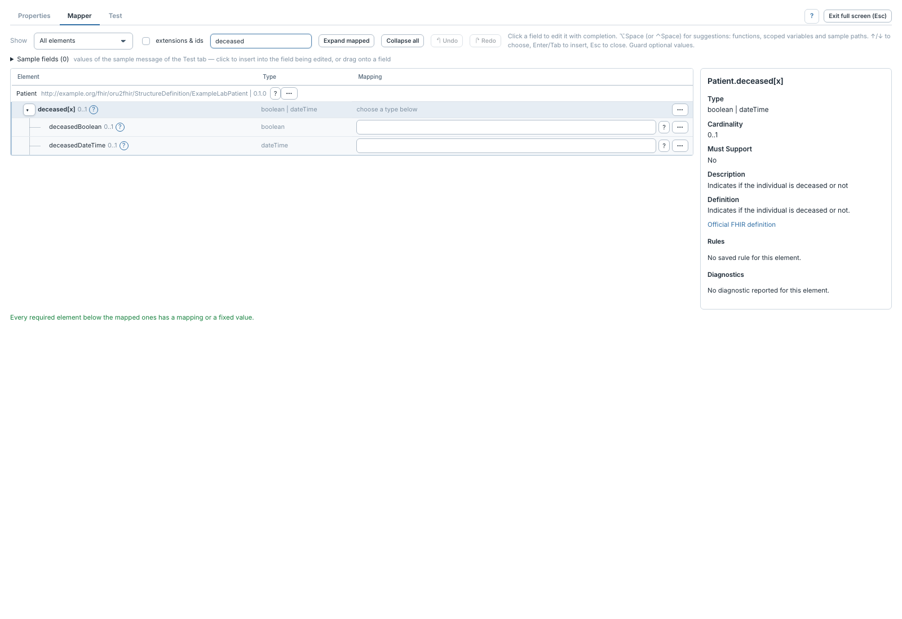

# Types choix, slices et valeurs fixes

[Manuel](../README.md) · [Profile Mapper](README.md)

Un profil impose des types et peut découper une collection en **slices**, c'est-à-dire
des occurrences identifiées par des contraintes particulières.

Dans la démo, `identifier:ipp` représente l'identifiant patient local. Mapper
`identifier:ipp.value` crée cette occurrence ; la valeur fixe de `system` est
ajoutée automatiquement quand la structure correspondante est construite.
L'inspecteur et les champs vides indiquent les contraintes **fixed** et **pattern**
disponibles. Il n'est pas nécessaire de recopier leur valeur dans une expression.

## Choisir un type

Un élément `[x]` offre plusieurs types. Déplier, par exemple, `deceased[x]`, puis
mapper `deceasedBoolean` pour produire un booléen ou `deceasedDateTime` pour une
date/heure. Le parent `[x]` ne reçoit pas d'expression lui-même.

Pour une [extension](extensions.md), le profil peut restreindre `[x]` à un seul
type, par exemple `valueCode` : celui-ci apparaît directement dans l'arbre.

Les contraintes du profil restent vérifiées par la validation FHIR. Le support
des sous-slices et de tous les types de discriminants n'est pas encore complet ;
ne pas considérer leur simple présence dans un IG comme une garantie de prise
en charge par le mappeur.
